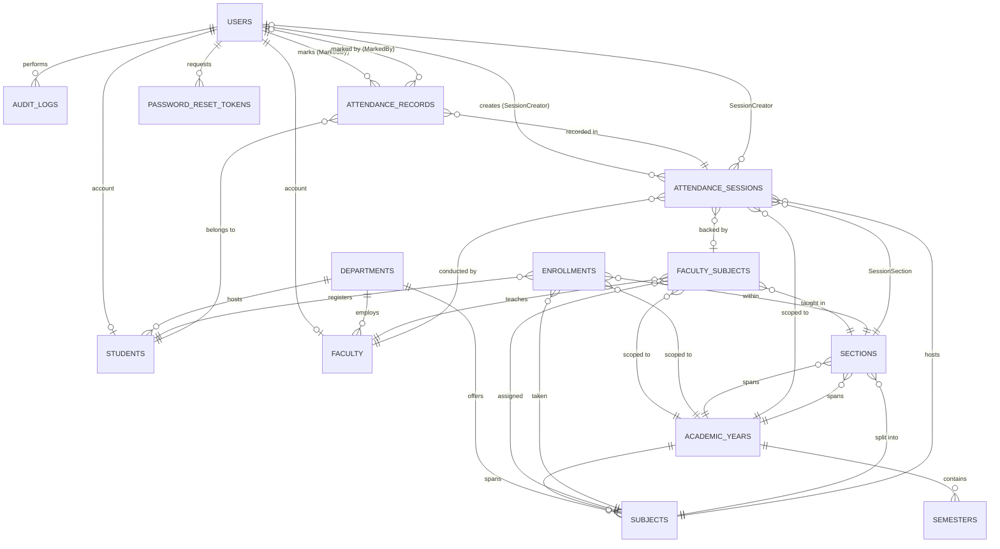

# AttendEase — Student Attendance Management System

## Project Report

A project report submitted in partial fulfilment of the requirements of the **Database Management
Systems (DBMS)** course.

---

### Title Page

| | |
| --- | --- |
| **Title of the Project** | AttendEase — Student Attendance Management System |
| **Project Type** | Full-stack web application (DBMS course project) |
| **Student Name** | [Student Name] |
| **Roll Number** | [Roll No.] |
| **Course** | [Course Name and Code] |
| **Institution** | [Institution Name and Address] |
| **Department** | [Department Name] |
| **Academic Year** | [Academic Year, e.g. 2025–2026] |
| **Project Guide / Supervisor** | [Guide Name, Designation, Department] |
| **Date of Submission** | [Submission Date] |

**Declaration**

I hereby declare that the project entitled *AttendEase — Student Attendance Management System* is a
record of genuine work carried out by me under the guidance of the project guide named above, in
partial fulfilment of the requirements for the Database Management Systems course. The database
schema, the normalisation analysis and the sample queries presented in this report are the result of
my own design work.

**Signature of the Student:** ____________________ &nbsp;&nbsp;&nbsp; **Date:** [Date]

**Signature of the Project Guide:** ____________________ &nbsp;&nbsp;&nbsp; **Date:** [Date]

---

## Abstract

AttendEase is a web-based Student Attendance Management System designed for a multi-department
academic institution. It replaces the manual register-based attendance process with a centralised,
auditable and role-segregated platform in which faculty members record attendance for the classes
they teach, students view their own attendance record, and administrators maintain the academic
structure and analyse attendance at the level of the individual, the subject, the section, the
department, the semester and the calendar month.

The system is implemented as a three-tier application. The presentation tier is a single-page React
application built with Vite and TypeScript. The application tier is a REST API built on Express 4 and
protected by a session cookie carrying a JSON Web Token, together with role-based access control,
double-submit-cookie CSRF protection, Zod request validation and rate limiting. The data tier is
MySQL 8 reached through the Prisma ORM, which guarantees parameterised access to the database and
translates the data model into a single, verifiable migration script.

The database comprises fourteen tables grouped into four conceptual areas: identity
(`users`, `password_reset_tokens`), academic structure (`departments`, `academic_years`, `semesters`,
`sections`, `subjects`), people (`students`, `faculty`) and the transactional core
(`faculty_subjects`, `enrollments`, `attendance_sessions`, `attendance_records`, `audit_logs`). Two
associative tables — `enrollments` and `faculty_subjects` — resolve the many-to-many relationships
between students and subjects, and between faculty members and subject/section/year combinations,
while a deliberately denormalised `section` label on `attendance_sessions` preserves the historical
reading of a session even if the underlying section is later re-labelled. Thirteen of the fourteen
relations satisfy the third normal form and all but one satisfy Boyce–Codd normal form; the one
conscious departure is a read-optimised snapshot column, which is justified and bounded in
Section 13.4.

Attendance is recorded per teaching session rather than per subject-day, so that a day with two
lectures produces two independently auditable sessions. A composite unique constraint over
`(subject_id, section_id, academic_year_id, attendance_date, session_number)` guarantees that a slot
cannot be double-booked, and a second constraint over `(attendance_session_id, student_id)`
guarantees exactly one attendance record per student per session. Percentage computations follow a
configurable policy in which `PRESENT` and `LATE` count as attended and the default low-attendance
threshold is 75 %. The application never destroys history: users, subjects and academic years are
soft-deactivated, and referential actions are chosen so that the audit trail survives deletion of
the entities that produced it. The single conscious departure from full normalisation — the section
label snapshot on `attendance_sessions` — is documented, justified and bounded in Section 13.4.

The report concludes with a normalisation analysis, twenty-one runnable MySQL 8 analytical queries,
the raw SQL equivalents of the five aggregate routines implemented in the service layer, a complete
REST API reference and an account of how each stated security requirement is met.

**Keywords:** Student Attendance Management System, MySQL 8, Prisma ORM, Express, React, normalised
relational schema, role-based access control, audit trail.

---

## 1. Introduction

Attendance is one of the most frequently recorded and most frequently contested pieces of academic
administration. A large number of institutions still record it on paper: the tutor calls names
aloud, a register is signed, and the register is later keyed into a spreadsheet or reconciled by
hand. The process is slow, it is lossy, and it produces no audit trail. When a student disputes a
count, the institution has no record beyond a line in a register, and the marks claimed in an
examination cannot be reconciled against the classes actually held.

The underlying difficulty is that the attendance domain is not merely a list of dates against a
list of names. A single student attends several subjects, each subject is delivered in one or more
sections, each section is taught by a member of staff in a given academic year, and each of those
lectures is a separate event that may be present, absent, late or on approved leave. The academic
structure itself is time-dependent: the same subject code is offered in different semesters and in
different academic years, and a student belongs to a section that changes as the cohort progresses.
Modelling this correctly — and doing so in a relational schema that a database engine can enforce —
is the substance of this project.

AttendEase addresses both halves of the problem: an application that makes marking attendance
fast and unambiguous for the person doing it, and a database design that makes the resulting data
trustworthy. The application is a three-tier web system. The presentation layer is a React single-
page application that renders a distinct workspace for each of the three user roles. The middle
layer is an Express REST API that owns authentication, authorisation, validation and the
aggregation logic behind every report. The data layer is MySQL 8 accessed through Prisma, so that
every statement is parameterised, every constraint is declared in one schema file and therefore
materialised in one reproducible migration, and every relationship is backed by a real foreign key.

The choice of MySQL 8 is deliberate. Its support for CTEs, window functions and generated indexes
makes the analytical queries in this report expressible directly against the operational tables
without a separate reporting database, and its strict enforcement of foreign keys and unique
indexes is what allows the business rules — one session per slot, one record per student per
session — to be guaranteed by the database rather than by application code alone.

The remainder of this report is organised as follows. Section 2 states the problem, Section 3 the
objectives, Section 4 compares the existing and proposed systems, Section 5 fixes the scope,
Sections 6 and 7 list the functional and non-functional requirements, Section 8 describes the
architecture, Sections 9 to 12 present the database design, ER diagram, relational schema and data
dictionary, Section 13 discusses normalisation, Section 14 presents the analytical queries,
Section 15 discusses testing, Section 16 lists the screens to be captured, Section 17 proposes
future work and Section 18 concludes.

---

## 2. Problem Statement

The problem addressed by this project may be stated as follows:

> Academic institutions require a reliable, auditable and easily accessible record of student
> attendance that is captured at the point of teaching, is scoped to the person responsible for
> teaching, survives changes in staffing and academic structure, and can be analysed at every level
> of the institutional hierarchy without manual reconciliation.

The specific deficiencies observed in the existing manual process are as follows.

1. **Incomplete and unverifiable records.** Paper registers are transcribed manually. Transcription
   errors are common, and there is no independent check that a mark in the register corresponds to
   a class that was actually held.
2. **No separation of duties.** The same person who takes the register also computes the
   percentage, and there is no mechanism to detect manipulation of either.
3. **No preservation of history.** When a student leaves a course, or a member of staff is
   transferred, the associated register entries are typically filed in a cupboard rather than
   retained in a queryable form. Six months later, nobody can answer "what was this student's
   attendance in this subject last semester?"
4. **No audit trail.** There is no record of *who* recorded a mark, *when* it was recorded, or
   *whether it was later corrected*. A correction is indistinguishable from the original entry.
5. **Arduous reporting.** Producing a short-attendance list for a single student, a subject or a
   department is a matter of opening several spreadsheets and copying figures by hand. The effort
   grows with the size of the institution and the reporting is rarely reproducible.
6. **Ambiguous policy.** Whether a student who is late, or on approved leave, has "attended" a
   class is a matter of local convention and is applied inconsistently.
7. **Poorly modelled data in general.** Even where software is used, the underlying structures are
   frequently flat — a single wide table of student names, roll numbers and per-subject counters —
   which makes it impossible to record more than one session per subject per day, cannot represent
   sections, and cannot be normalised without losing data.

The proposed system must therefore deliver, at minimum: rapid attendance capture with a per-student
status and a remark; automatic computation of percentages under an explicit, configurable policy;
immediate flagging of students below a defined threshold; a complete, tamper-evident audit trail;
reports at the level of student, subject, class, department, semester, faculty, date and month;
role-based access control that confines a user to their legitimate scope; and a database schema that
is normalised to the third normal form, with one documented and bounded exception, that enforces
its own integrity, and that preserves attendance history irrespective of later administrative
action.

---

## 3. Objectives

The project was undertaken with the following objectives.

**O1 — Model the academic domain correctly.** Design a relational schema for departments, academic
years, semesters, subjects, sections, students, faculty, teaching assignments, enrolments,
attendance sessions, attendance records, users and audit logs that captures the real structure of a
multi-department institution, including the time-dependence of the academic calendar and the
many-to-many nature of enrolment and teaching allocation.

**O2 — Guarantee integrity at the database level.** Express every business rule that can be
expressed as a constraint as an actual `NOT NULL`, `UNIQUE` or `FOREIGN KEY` constraint, so that the
database — not merely the application — guarantees that a session slot cannot be double-booked and
that a student cannot have two records for the same session.

**O3 — Achieve a high normal form.** Bring every transactional relation to the third normal form,
and to Boyce–Codd normal form where the dependency structure permits, while documenting and
bounding the single deliberate denormalisation (the section label snapshot on
`attendance_sessions`).

**O4 — Build a usable application.** Provide a web application in which marking a class of
students takes a single screen and a single submit action, and in which the administrative and
reporting functions are available without writing any SQL.

**O5 — Implement report generation.** Provide student-wise, subject-wise, class-wise,
department-wise, date-wise, monthly, semester-wise, faculty-wise and low-attendance reports, each
filterable by academic year, semester, department, subject, section, student, faculty and date
range, and exportable to CSV.

**O6 — Enforce separation of duties.** Ensure that faculty members can only mark attendance for the
subjects and sections they are assigned to teach, that students can only read their own record, and
that administrative functions are restricted to administrators — enforced on the server, not merely
hidden in the user interface.

**O7 — Secure the application.** Implement a defence-in-depth security posture: bcrypt password
hashing, JWT sessions in httpOnly cookies, double-submit CSRF protection, server-side RBAC, schema
based input validation, rate limiting, security headers, a CORS allow-list and a complete audit
log.

**O8 — Preserve history.** Ensure that no administrative action — deactivating a student,
deactivating a subject, deleting an academic year — destroys historical attendance, and that the
referential actions on every foreign key reflect that requirement.

**O9 — Produce analytical queries.** Express the institutional questions — who is falling below the
threshold, how do departments compare, which classes were never marked, who taught what — as
efficient MySQL 8 queries that a database administrator can run directly.

---

## 4. Existing System vs Proposed System

### 4.1 Description of the existing system

The existing system at the reference institution is a manual, register-based process:

- Each faculty member maintains a printed attendance register for every class they teach. The
  register is a table of student roll numbers and dates, with a present, absent or late marker per
  cell.
- At the end of each month the faculty member totals the columns of the register by hand and enters
  the totals into a departmental spreadsheet.
- The departmental spreadsheet is a flat table: one row per student per subject, with a running
  total of classes held, classes attended and a percentage.
- Short-attendance cases are identified by sorting the spreadsheet manually and circulating a
  printed notice.
- A register is retained for the academic year and then archived in paper form. It is not queryable
  and cannot be reconciled against examination records without manual effort.

### 4.2 Comparative analysis

| Dimension | Existing (manual) system | Proposed (AttendEase) system |
| --- | --- | --- |
| Data capture | Handwritten register at the moment of the class | Single-screen web form; the roster is loaded from the enrolment table automatically |
| Capture time | Per class, per student, per cell | One submit action for the whole class; transactional bulk upsert |
| Storage medium | Paper registers and departmental spreadsheets | MySQL 8 relational database with declared constraints |
| Accuracy | Dependent on manual transcription; errors are undetectable | Data written once by the application; unique constraints prevent duplicate marks |
| Sessions per day | Not representable — one row per subject per day | Fully modelled — `session_number` distinguishes multiple sessions on one date |
| Sections | Not represented | First-class entity (`sections`) with a composite unique key per subject/year |
| Student/subject relationship | Duplicated as columns in the spreadsheet | Resolved by the `enrollments` bridge table with a unique constraint per student/subject/year |
| Faculty/subject relationship | Recorded informally | Resolved by the `faculty_subjects` bridge table with a unique constraint per faculty/subject/section/year |
| Percentage computation | Manual addition; local and inconsistent | Computed server-side under one configurable policy (`ATTENDANCE_COUNTED_STATUSES`, default `PRESENT,LATE`) |
| Threshold monitoring | Manual sort and printed notices | Automatic flagging below `ATTENDANCE_THRESHOLD_PERCENT` (default 75) on dashboards and in the low-attendance report |
| Reporting | Manual consolidation, days of effort, not reproducible | Nine report types, filterable, on-screen, CSV export, backed by indexed SQL |
| Data over time | Re-keyed each month; history in files | Rows accumulate; reports cover any date range in any year without re-keying |
| Correction of a mark | Erasure and re-signing; no record of the change | `PUT /api/attendance/records/:id`; the previous and new values are written to the audit log with the timestamp and the correcting user |
| Authentication | Physical signature / roll call | Password + JWT session in an httpOnly cookie, bcrypt hashing, CSRF protection, rate limiting |
| Authorisation | Trust in the person holding the register | Server-side RBAC; a faculty member may only mark the subjects assigned to them |
| Audit trail | None | `audit_logs` records actor, action, entity, details, IP address and timestamp for every mutating operation |
| Integrity enforcement | None | 14 tables, 30 foreign keys, 9 unique indexes, 5 additional secondary indexes, enforced by MySQL |
| Availability | Depends on the physical register | Concurrent access, with the database arbitrating conflicts |

### 4.3 Advantages of the proposed system

1. **Speed and accuracy.** The roster is derived from `enrollments`, so the faculty member never
   transcribes a roll number; the whole class is submitted in one transaction, and the unique
   constraint `(attendance_session_id, student_id)` makes double-submission harmless.
2. **A single source of truth.** Percentages, dashboards and reports are all derived from
   `attendance_records` by the same aggregation functions, so a figure shown on a dashboard and the
   same figure in an exported report cannot disagree.
3. **Defensible records.** Every mark carries the identity of the person who made it, the time it
   was made, and the history of any correction.
4. **Historical continuity.** Soft deactivation and carefully chosen `ON DELETE` actions mean that
   administrative turnover never erases attendance history.
5. **Institutional analytics.** Department and semester comparisons, monthly trends and
   short-attendance lists that previously required days of manual consolidation are now a single
   indexed query.

### 4.4 Limitations of the proposed system

1. It requires network connectivity and a running server; the paper register remains a useful
   contingency.
2. The attendance threshold and the set of statuses that count as "attended" are configuration, not
   policy per department.
3. It does not replace a learning-management system; there is no assignment, grade or plagiarism
   tracking.
4. Biometric or geofenced attendance, which some institutions require, is not implemented.

---

## 5. Scope

### 5.1 In scope

**Identity and access**
- Registration of administrator-managed accounts for students and faculty members.
- Login, logout and session restoration (`POST /api/auth/login`, `POST /api/auth/logout`,
  `GET /api/auth/me`).
- Change of one's own password and update of one's own display name.
- Administrator-initiated password reset for a student or faculty member.
- Forgotten-password flow using single-use, hashed, time-limited tokens.
- Three roles — `ADMIN`, `FACULTY`, `STUDENT` — with server-side enforcement.

**Academic master data (administrator only)**
- Departments (name and unique code).
- Academic years (name, start and end dates, active flag).
- Semesters (number, owning academic year, dates, active flag).
- Subjects (code, name, department, semester, academic year, credits, active flag).
- Sections (subject + section label + academic year).
- A combined options endpoint returning every list needed to populate the filter bars.

**People**
- Student records with roll number, department, semester, section and admission year.
- Faculty records with faculty identifier, department and designation.
- Bulk import of students from a JSON row array, with per-row validation and error collection.
- CSV export of students and of faculty.
- Deactivation and reactivation of accounts.

**Allocation**
- Faculty-subject-section-year assignments, with the section/subject and section/year consistency
  rules enforced by the application and the uniqueness of the assignment enforced by the database.
- Bulk enrolment of students into a subject, optionally within a section, with duplicate enrolments
  skipped rather than rejected.
- A subject roster endpoint that returns the enrolled students ordered by roll number.

**Attendance**
- Creation of an attendance session for a subject, section, date and session number, subject to the
  rules that the date must not be in the future, the section must belong to the subject, a teaching
  assignment must exist, and the slot must not already be taken.
- A marking screen that loads the roster and lets the faculty member set `PRESENT`, `ABSENT`,
  `LATE` or `ON_LEAVE` with an optional remark per student.
- Submission of the whole class in one transactional upsert.
- Correction of an individual record after the fact.
- Cancellation of a session, which removes it from every percentage computation without deleting
  it.
- Today's sessions, session history and record history, all scoped to the caller.

**Reporting and analysis**
- Student-wise, subject-wise, class-wise, department-wise, date-wise, monthly, semester-wise,
  faculty-wise and low-attendance reports.
- CSV export of any report, of the student list, of the faculty list and of the audit log.
- Role-scoped dashboards for administrators, faculty members and students, including a seven-day
  trend, department and subject breakdowns and a low-attendance watchlist.

**Audit and administration**
- An audit log of every mutating operation, filterable by action, entity type, user and date
  range, with CSV export.
- A health endpoint reporting database connectivity and process uptime.

### 5.2 Out of scope

- **Biometric, RFID, QR-code or geolocation-based attendance.** Attendance is captured manually by
  the faculty member present in the class.
- **Examination, marks and grading.** The system stops at attendance.
- **Fee management, admissions, timetabling and room allocation.**
- **Student accommodation, library circulation or hostel attendance.**
- **Notification delivery.** There is no SMTP integration; the password-reset token is returned by
  the API in non-production environments so that the flow remains testable end to end.
- **A native mobile application.** The interface is a responsive web application.
- **Multi-institution tenancy.** The schema assumes one institution.
- **Automatic synchronisation with the institution's ERP or examination system.**
- **Attendance via a public-facing kiosk**, which would require a different authentication model.
- **Machine-learning prediction of future attendance.** The analytics are descriptive, not
  predictive.

---

## 6. Functional Requirements

The functional requirements are stated with identifiers used throughout the implementation and
verification.

### 6.1 Authentication and account management

| ID | Requirement |
| --- | --- |
| FR-1 | The system shall authenticate a user by e-mail address and password, and shall reject the request with HTTP 401 if either is wrong or the account is inactive. |
| FR-2 | On successful authentication the system shall issue a signed JWT in an httpOnly cookie named `attendease_token` and a CSRF token in a readable cookie named `attendease_csrf`. |
| FR-3 | The system shall return the signed-in user's profile together with a fresh CSRF token on `GET /api/auth/me`. |
| FR-4 | The system shall clear both cookies on logout and shall write a `LOGOUT` audit entry. |
| FR-5 | The system shall allow a signed-in user to change their password after verifying the current password. |
| FR-6 | The system shall allow a signed-in user to update their display name. |
| FR-7 | The system shall allow an administrator to reset the password of any student or faculty account without knowing the previous password. |
| FR-8 | The system shall implement a forgotten-password flow in which a time-limited, single-use token is issued, stored only as a SHA-256 hash, and consumed on use. |
| FR-9 | The forgotten-password response shall not disclose whether the given e-mail address exists. |
| FR-10 | The system shall allow an administrator to create, deactivate and reactivate student and faculty accounts. |

### 6.2 Academic master data

| ID | Requirement |
| --- | --- |
| FR-11 | The system shall allow an administrator to create, list, retrieve, update and delete departments, academic years, semesters, subjects and sections. |
| FR-12 | The system shall reject the creation of a department whose code already exists (HTTP 409). |
| FR-13 | The system shall reject the creation of a duplicate semester number within the same academic year (HTTP 409). |
| FR-14 | The system shall reject the creation of a section offering that already exists for the same subject, section label and academic year (HTTP 400). |
| FR-15 | The system shall refuse to delete a department, academic year, semester or section that is still referenced, and shall advise deactivation instead (HTTP 400). |
| FR-16 | The system shall deactivate, rather than delete, a subject that already carries attendance sessions. |
| FR-17 | The system shall expose a single endpoint returning departments, academic years, semesters, active subjects and sections for populating filter controls. |

### 6.3 Allocation

| ID | Requirement |
| --- | --- |
| FR-18 | The system shall allow an administrator to assign a faculty member to a subject, section and academic year, and shall reject a duplicate assignment (HTTP 409). |
| FR-19 | The system shall reject an assignment whose section belongs to a different subject or to a different academic year (HTTP 400). |
| FR-20 | The system shall refuse to remove an assignment that already has attendance sessions attached (HTTP 400). |
| FR-21 | The system shall allow an administrator to enrol one or more students into a subject for an academic year, optionally within a section, skipping students who are already enrolled and reporting the number created and skipped. |
| FR-22 | The system shall refuse to remove an enrolment for which the student already has attendance records in that subject (HTTP 400). |
| FR-23 | The system shall provide the enrolled roster of a subject, optionally restricted to a section, ordered by roll number. |
| FR-24 | The system shall restrict the roster, the assignment list and the enrolment list to the subjects the calling faculty member teaches. |

### 6.4 Attendance capture

| ID | Requirement |
| --- | --- |
| FR-25 | The system shall allow an administrator or a faculty member to create an attendance session for a subject, section, date and session number. |
| FR-26 | The system shall reject a session for a future date (HTTP 400). |
| FR-27 | The system shall reject a session whose section does not belong to the chosen subject (HTTP 400). |
| FR-28 | The system shall reject a session for which no teaching assignment exists, with HTTP 403 for a faculty member and HTTP 400 for an administrator (HTTP 403 / 400). |
| FR-29 | The system shall reject a session that duplicates an existing slot (HTTP 409). |
| FR-30 | The system shall load the roster for a session from the enrolments of that subject and section. |
| FR-31 | The system shall record one attendance status per student from the set `PRESENT`, `ABSENT`, `LATE`, `ON_LEAVE`, with an optional remark of up to 255 characters. |
| FR-32 | The system shall reject a submission that includes a student who is not enrolled in that subject and section (HTTP 400). |
| FR-33 | The system shall reject a submission that lists the same student more than once (HTTP 400). |
| FR-34 | The system shall save a whole submission atomically and idempotently, so that re-submitting the same class updates rather than duplicates the records. |
| FR-35 | The system shall allow an administrator or the owning faculty member to correct a single attendance record, recording the previous and new status in the audit log. |
| FR-36 | The system shall allow an administrator or a faculty member to cancel a session, after which the session is excluded from all percentage computations but retained in the database. |
| FR-37 | The system shall reject marking attendance against a cancelled session (HTTP 400). |

### 6.5 Attendance retrieval

| ID | Requirement |
| --- | --- |
| FR-38 | The system shall list attendance sessions with filtering by subject, faculty, section, academic year, department, date or date range, and free-text search over the subject name, subject code and topic. |
| FR-39 | The system shall list the sessions scheduled for the current day. |
| FR-40 | The system shall retrieve a single session with its roster, the status of each student, the marking officer and the aggregate summary. |
| FR-41 | The system shall list individual attendance records with the same filter set. |
| FR-42 | The system shall return, for a given student, the overall percentage, the subject-wise breakdown and the monthly breakdown. |
| FR-43 | The system shall return, for a given subject, the number of eligible sessions, the number attended and the percentage. |
| FR-44 | The system shall allow a student to read only their own attendance, and a faculty member only the attendance of students enrolled in subjects they teach (HTTP 403 otherwise). |

### 6.6 Reporting

| ID | Requirement |
| --- | --- |
| FR-45 | The system shall provide the nine report types listed in Section 6.6.1. |
| FR-46 | The system shall filter every report by academic year, semester, department, subject, section, student, faculty and date range. |
| FR-47 | The system shall exclude cancelled sessions and sessions dated in the future from every report. |
| FR-48 | The system shall compute attendance percentage as the number of attended eligible sessions divided by the number of eligible sessions, with `PRESENT` and `LATE` counted as attended and `ON_LEAVE` optionally counted, rounded to two decimal places. |
| FR-49 | The system shall export any report, the student list, the faculty list and the audit log as CSV. |
| FR-50 | The system shall scope reports to the caller's permissions: a faculty member sees only the subjects they teach, a student sees only their own record. |

#### 6.6.1 Report types

| `reportType` | Title | Grouping |
| --- | --- | --- |
| `student-wise` | Student-wise Attendance Report | One row per student, ascending by percentage |
| `subject-wise` | Subject-wise Attendance Report | One row per subject |
| `class-wise` | Class-wise Attendance Report | One row per subject and section |
| `department-wise` | Department-wise Attendance Report | One row per department |
| `date-wise` | Date-wise Attendance Report | One row per calendar date |
| `monthly` | Monthly Attendance Report | One row per calendar month |
| `semester-wise` | Semester-wise Attendance Report | One row per semester |
| `low-attendance` | Low Attendance Report (below *n*%) | Students below the configured threshold |
| `faculty-wise` | Faculty-wise Attendance Report | One row per faculty member |

### 6.7 Audit and operations

| ID | Requirement |
| --- | --- |
| FR-51 | The system shall write an audit entry for every create, update, delete, deactivate, reactivate, password change, password reset, login and logout operation, recording the acting user, the action, the entity type and identifier, a JSON detail payload and the client IP address. |
| FR-52 | An audit failure shall never cause the audited operation to fail. |
| FR-53 | The system shall allow an administrator to list and filter audit entries and to export them to CSV. |
| FR-54 | The system shall expose a health endpoint reporting database connectivity, process uptime and the current timestamp, returning HTTP 503 when the database is unreachable. |

### 6.8 Data integrity requirements

| ID | Requirement |
| --- | --- |
| FR-55 | Every attendance session shall be uniquely identified by subject, section, academic year, date and session number. |
| FR-56 | Every attendance record shall be uniquely identified by session and student. |
| FR-57 | Every enrolment shall be unique per student, subject and academic year. |
| FR-58 | Every teaching assignment shall be unique per faculty member, subject, section and academic year. |
| FR-59 | Every section offering shall be unique per subject, section label and academic year. |
| FR-60 | Every semester number shall be unique within its academic year. |

---

## 7. Non-Functional Requirements

| ID | Category | Requirement |
| --- | --- | --- |
| NFR-1 | Performance | A listing endpoint shall return a paginated result set (default page size 10, maximum 100) and shall satisfy a typical request within 500 ms on the reference dataset. |
| NFR-2 | Performance | Percentage and report computations shall be performed against indexed columns so that the analytical queries in Section 14 remain interactive over a full academic year of data. |
| NFR-3 | Performance | The request body shall be limited to 1 MB and an attendance submission shall be limited to 1000 records per request. |
| NFR-4 | Scalability | The schema shall support multiple departments, academic years running in parallel, an arbitrary number of sections per subject and an arbitrary number of sessions per subject per day, without alteration. |
| NFR-5 | Security | Passwords shall be stored as bcrypt hashes with a cost factor of 12 and shall never be logged or returned by any endpoint. |
| NFR-6 | Security | The session credential shall be carried in an httpOnly, SameSite cookie that is marked `Secure` when `SECURE_COOKIES` is enabled. |
| NFR-7 | Security | Every state-changing request shall require a matching double-submit CSRF token presented in the `X-CSRF-Token` header. |
| NFR-8 | Security | Access control shall be enforced on the server for every endpoint; hiding a control in the user interface shall never be the only protection. |
| NFR-9 | Security | All request bodies, query strings and route parameters shall be validated against a Zod schema before a controller runs. |
| NFR-10 | Security | The API shall be rate limited, and shall answer HTTP 429 when the limit is exceeded. |
| NFR-11 | Security | The API shall send the Helmet security-header set and shall accept browser origins only from an explicit allow-list. |
| NFR-12 | Security | All database access shall be parameterised; no query shall be built by string concatenation of user input. |
| NFR-13 | Security | Every mutating operation shall be attributable from the audit log. |
| NFR-14 | Reliability | Historical attendance shall never be destroyed by deactivating or deleting a user, subject, section or academic year. |
| NFR-15 | Reliability | A multi-record attendance submission shall be atomic: either every record in the submission is saved or none is. |
| NFR-16 | Usability | The interface shall provide a dedicated workspace for each role, with navigation that reflects the caller's permissions. |
| NFR-17 | Usability | The marking screen shall load the roster automatically and shall allow the whole class to be submitted in one action. |
| NFR-18 | Usability | All lists shall be paginated, sortable where meaningful and filterable, and shall display empty, loading and error states. |
| NFR-19 | Portability | The application shall run on any machine with Node.js 20 or later and MySQL 8, configured entirely through environment variables. |
| NFR-20 | Maintainability | The database definition shall exist in a single schema file and shall be materialised by a single, version-controlled, repeatable migration. |
| NFR-21 | Maintainability | All configuration shall be validated at start-up; an invalid environment shall prevent the server from starting rather than fail at the first request. |
| NFR-22 | Maintainability | The API shall expose a consistent response envelope across every endpoint. |
| NFR-23 | Compatibility | The API shall return dates as `YYYY-MM-DD` strings and store date-only values at UTC midnight, so that no timezone drift can occur. |
| NFR-24 | Observability | The server shall emit request logs in `dev` format in development and `combined` format in production, with the log level configurable. |

---

## 8. System Architecture

### 8.1 Architectural style

AttendEase is a three-tier, request/response web application with a strict separation of concerns.

```text
┌───────────────────────────────────────────────────────────────────────────┐
│  PRESENTATION TIER — React 18 + Vite 6 + TypeScript + Tailwind CSS 4    │
│  frontend/src/                                                           │
│                                                                           │
│   pages/ (admin | faculty | student | auth | error)                       │
│   components/ (layout, tables, filters, charts, dialogs, ui primitives)  │
│   hooks/use-auth.tsx  (session context)                                   │
│   lib/api.ts  (fetch wrapper: credentials, CSRF header, error mapping)   │
└───────────────┬───────────────────────────────────────────────────────────┘
                │  HTTPS / JSON over fetch()
                │  Cookie: attendease_token (httpOnly, SameSite=Lax)
                │  Header: X-CSRF-Token: <attendease_csrf cookie value>
┌───────────────▼───────────────────────────────────────────────────────────┐
│  APPLICATION TIER — Express 4.21 REST API — backend/src                  │
│                                                                           │
│   middleware/  helmet → CORS allow-list → body parsers → cookie-parser    │
│                → apiLimiter (429) → csrfProtection (403)                  │
│                → requireAuth (401) → requireRole (403) → validate (422)    │
│                → controller → asyncHandler → errorHandler                │
│                                                                           │
│   routes/      resource route tables with role guards                     │
│   controllers/ HTTP shaping only: parse request, call service, respond   │
│   services/    attendance.service.ts, report.service.ts,                  │
│                auth.service.ts, audit.service.ts                          │
│   validators/  Zod schemas for body / query / params                      │
│   utils/       response envelope, typed errors, CSV, crypto, dates        │
└───────────────┬───────────────────────────────────────────────────────────┘
                │  Prisma Client 6.2 — parameterised statements, no raw SQL
                │  prepared by the application
┌───────────────▼───────────────────────────────────────────────────────────┐
│  DATA TIER — MySQL 8.x, schema `attendance_management`                    │
│                                                                           │
│   14 tables · 2 ENUM types · 30 FOREIGN KEY constraints ·               │
│   15 UNIQUE indexes (9 single-column + 6 compound) ·                    │
│   30 secondary indexes · InnoDB · utf8mb4 / utf8mb4_unicode_ci           │
└───────────────────────────────────────────────────────────────────────────┘
```

### 8.2 The three tiers in detail

#### 8.2.1 Presentation tier

The presentation tier is a React 18 single-page application built with Vite 6 and TypeScript. It
uses React Router 6 for navigation, TanStack Query 5 for server-state management, React Hook Form
with Zod resolvers for forms, Radix UI primitives for accessible dialogs, menus and selects,
Recharts for the dashboard charts and Tailwind CSS 4 for styling.

The routing table is organised by role and is protected declaratively. A `ProtectedRoute` wrapper
redirects an unauthenticated visitor to `/login` and an authenticated visitor whose role is not
permitted to a route to `/unauthorized`. Three role workspaces exist:

- **Administrator** — dashboard, students, faculty, departments, academic years, semesters, subjects,
  sections, faculty assignments, enrolments, attendance, reports, audit logs, settings.
- **Faculty** — dashboard, my subjects, my classes, student list, mark attendance, attendance
  history, reports, profile.
- **Student** — dashboard, my attendance, subject attendance, attendance history, reports, profile.

All server access goes through a single wrapper, `frontend/src/lib/api.ts`, which guarantees three
invariants: the session cookie is always sent (`credentials: 'include'`); the CSRF token is read
from the readable `attendease_csrf` cookie and attached as `X-CSRF-Token` on every mutating request;
and a non-2xx response, or a payload with `success: false`, is converted into a typed `ApiError`
carrying the status, code and details. The frontend therefore contains no API base URL hard-coded
beyond the optional `VITE_API_URL`, no credential and no secret of any kind.

#### 8.2.2 Application tier

The application tier is an Express 4 REST API. The pipeline for every request under `/api` is:

1. **Helmet** applies the default security headers; the Content-Security-Policy is disabled in
   development to avoid interfering with the Vite dev server and enabled in production.
2. **CORS** consults an allow-list built from `CORS_ORIGINS` (defaulting to `APP_URL`). A request
   with no `Origin` header — a same-origin navigation or a non-browser client — is allowed; an
   origin outside the list is rejected. `credentials: true` is set so that the session cookie
   travels with cross-origin XHR.
3. **Body parsers** accept JSON and URL-encoded bodies up to 1 MB; **cookie-parser** makes the
   session and CSRF cookies available to the middleware.
4. **`apiLimiter`** enforces a global limit (default 300 requests per 15-minute window) and answers
   HTTP 429 with the standard error envelope when exceeded.
5. **`csrfProtection`** enforces double-submit CSRF protection on every method other than `GET`,
   `HEAD` and `OPTIONS`, with the four unauthenticated endpoints explicitly exempted.
6. **Route-level guards** — `requireAuth` verifies the JWT and re-checks that the account is still
   active in the database; `requireRole(...)` then checks the caller's role. `requireRole` is
   implemented as the pair `[requireAuth, checkRole]`, so a role check can never be reached without
   an authenticated session.
7. **`validate`** parses the request body, query string and route parameters against Zod schemas and
   **replaces** the request parts with the parsed output, so that a handler always receives
   coerced, trimmed and correctly typed data.
8. **Controller** performs HTTP shaping and delegates the domain work to a service.
9. **`errorHandler`** converts every thrown value into the standard error envelope: a `ZodError`
   becomes HTTP 422 with a field-by-field breakdown; Prisma error `P2002` becomes HTTP 409
   (`UNIQUE_CONSTRAINT`), `P2003` becomes HTTP 409 (`FOREIGN_KEY_CONSTRAINT`) and `P2025` becomes
   HTTP 404; a typed `AppError` keeps its own status, code and details; anything else is logged
   server-side and reported as a generic HTTP 500 so that stack traces never reach the client.

#### 8.2.3 Data tier

The data tier is MySQL 8.x accessed exclusively through Prisma Client 6.2. Prisma generates a
type-safe client from `backend/prisma/schema.prisma` and emits parameterised SQL for every
operation; the application contains no hand-written SQL string that interpolates user input. The
single migration `20260101000000_init` creates all fourteen tables with their indexes and all
thirty foreign keys, and is applied with `prisma migrate deploy`.

### 8.3 Request and response envelope

Every JSON endpoint returns one of two shapes.

**Success, single resource or collection**

```json
{
  "success": true,
  "data": { "...": "..." }
}
```

**Success, paginated collection**

```json
{
  "success": true,
  "data": [ { "...": "..." } ],
  "meta": {
    "page": 1,
    "pageSize": 10,
    "total": 120,
    "totalPages": 12
  }
}
```

`meta` is present only on paginated responses and is produced by `sendPaginated`. The `page` and
`pageSize` values are validated (page ≥ 1, page size between 1 and 100) and coerced to numbers
before the controller sees them.

**Error**

```json
{
  "success": false,
  "error": {
    "code": "VALIDATION_ERROR",
    "message": "The submitted data is invalid",
    "details": [ { "field": "email", "message": "Enter a valid email address" } ]
  }
}
```

`code` is a stable, machine-readable identifier; `message` is safe to display; `details` is
present only when the error carries structured information (field-level validation issues, the
student identifiers of an invalid enrolment set, the conflicting fields of a unique-constraint
violation).

Two deliberate exceptions to the JSON envelope exist and are documented in the API reference:
the CSV export endpoints return `text/csv` with a `Content-Disposition` header, and
`GET /api/health` returns the envelope directly rather than through `sendSuccess`, so that it can
report HTTP 503 when the database is unreachable.

### 8.4 End-to-end request trace

The trace below follows a single marking operation and names the actual route, controller,
service and table involved.

1. `POST /api/auth/login` — the credentials are validated by `loginSchema`, checked by
   `authenticate()` in `auth.service.ts` (a bcrypt comparison is always performed, even for an
   unknown address, so that the response time does not disclose whether the account exists), and a
   JWT is signed with `sub`, `role`, `name` and `email` claims. The token is placed in the
   `attendease_token` cookie and a CSRF token in `attendease_csrf`. A `LOGIN` audit entry is
   written.
2. `POST /api/attendance/sessions` — the faculty member creates today's session. The controller
   rejects a future date, loads the section, verifies that the section belongs to the subject, and
   finds a `faculty_subjects` row for that subject, section and academic year belonging to the
   caller; without one it answers HTTP 403. It then probes the `unique_session_slot` key and
   answers HTTP 409 if the slot is taken, and otherwise inserts a row into `attendance_sessions`
   with a snapshot of the section label.
3. `GET /api/attendance/sessions/:id` — the roster is built by reading `enrollments` for the
   subject and section and joining the existing `attendance_records` for that session, so that the
   faculty member sees the enrolled students with their current status, if any.
4. `POST /api/attendance/sessions/:id/records` — the controller loads the session, rejects a
   cancelled session, checks that the caller owns it, verifies that every submitted `studentId`
   appears in the enrolment set and that no student appears twice, and then runs a single
   `prisma.$transaction` of upserts keyed on `unique_student_per_session`. The response carries the
   aggregate summary, and a `SUBMIT_ATTENDANCE` audit entry is written.
5. `GET /api/reports?reportType=student-wise` — `report.service.ts` loads the eligible sessions
   (not cancelled, not in the future) and their records, groups them by student and computes the
   percentages; the low-attendance variant filters the result to rows below the threshold.

### 8.5 Component and deployment view

The backend and the frontend are separate npm workspaces under a single root package, orchestrated
by `concurrently` in development (`npm run dev` starts both). In production the Express server
serves the compiled frontend from `frontend/dist` as static assets and falls back to `index.html`
for client-side routes, so a single container serves the whole application. Configuration is
supplied entirely through environment variables, validated at start-up by a Zod schema in
`backend/src/config/env.ts`; an invalid configuration aborts the boot rather than failing at the
first request.

---

## 9. Database Design

### 9.1 Design principles

The schema was designed against four principles.

1. **One fact, one place.** A fact that can change — the name of a student, the code of a subject,
   the status of an attendance record — is stored once and referenced elsewhere. Repeated copies
   are introduced only where the copy is explicitly a historical snapshot, and the snapshot is
   justified in Section 13.4.
2. **The database enforces the rules.** Every invariant that can be expressed as a constraint is
   expressed as a constraint. A duplicate session slot, a duplicate attendance record, a duplicate
   enrolment, a duplicate teaching assignment and a duplicate section offering are all impossible
   at the storage-engine level, independently of application code.
3. **History is never destroyed.** `onDelete: Restrict` is used on every foreign key that leads to
   attendance history, `onDelete: SetNull` on every foreign key that records an actor or an
   optional attribution, and `onDelete: Cascade` only where the child rows cannot themselves carry
   history. Entities are additionally soft-deactivated through `is_active` flags.
4. **Time is a first-class dimension.** Every structure that varies between years carries
   `academic_year_id`, and the composite unique keys always include it, so that the same subject
   code offered in two different years remains two distinct rows.

### 9.2 Entity groups

The fourteen tables fall into four groups.

**Identity.** `users` holds the credential, the display name, the e-mail address, the role and the
active flag for every person who can sign in. `password_reset_tokens` holds single-use,
SHA-256-hashed reset tokens with an expiry and a use timestamp. The split between `users` and the
role-specific `students` and `faculty` tables keeps authentication concerns out of the academic
model: a person's name and e-mail are properties of the account, whereas a roll number is a
property of a student and a designation is a property of a member of staff.

**Academic structure.** `departments` → `academic_years` → `semesters` → `subjects` → `sections`
forms a hierarchy in which each level is referenced by the level below it. `subjects` additionally
carries `department_id` and `academic_year_id` directly, because a subject is owned by a department
and is offered in a particular year, and because reports are routinely filtered on those two
attributes.

**People.** `students` and `faculty` are thin extensions of `users` carrying the
institution-specific attributes and a mandatory one-to-one link to their account, enforced by a
unique constraint on `user_id`.

**Transactional core.** `faculty_subjects` records who teaches what, where and when;
`enrollments` records who is registered for what, where and when; `attendance_sessions` records a
single lecture; `attendance_records` records a single student's state in that lecture;
`audit_logs` records who did what.

### 9.3 Entity–relationship diagram

The full diagram is presented in [`02-er-diagram.md`](./02-er-diagram.md). Its principal features
are summarised here.



### 9.4 Relational schema

The full DDL, reproduced verbatim from the applied migration, together with a per-table column
table, is presented in [`03-relational-schema.md`](./03-relational-schema.md). The tables are
summarised below.

| Table | Purpose | Key columns |
| --- | --- | --- |
| `users` | Credentials and role for every account | `id`, `email` (unique), `password_hash`, `role`, `is_active` |
| `password_reset_tokens` | Single-use reset tokens | `token_hash` (unique), `expires_at`, `used_at` |
| `departments` | Teaching departments | `department_code` (unique) |
| `academic_years` | Academic calendar | `year_name` (unique), `start_date`, `end_date`, `is_active` |
| `semesters` | Semesters within a year | `academic_year_id`, `semester_number` (unique per year) |
| `sections` | Teaching sections of a subject | `subject_id`, `section`, `academic_year_id` (unique together) |
| `students` | Student particulars | `user_id` (unique), `roll_number` (unique), `department_id`, `semester_id`, `section` |
| `faculty` | Staff particulars | `user_id` (unique), `faculty_id` (unique), `department_id`, `designation` |
| `subjects` | Subjects offered | `subject_code` (unique), `department_id`, `semester_id`, `academic_year_id`, `credits`, `is_active` |
| `faculty_subjects` | Teaching assignments | `faculty_id`, `subject_id`, `section_id`, `academic_year_id` (unique together) |
| `enrollments` | Student registrations | `student_id`, `subject_id`, `academic_year_id` (unique together), nullable `section_id` |
| `attendance_sessions` | One lecture of one section | `subject_id`, `faculty_id`, `section_id`, `attendance_date`, `session_number` (unique together), `section` snapshot, `is_cancelled` |
| `attendance_records` | One student's state in one session | `attendance_session_id`, `student_id` (unique together), `attendance_status`, `marked_by`, `remarks` |
| `audit_logs` | Audit trail | `user_id`, `action`, `entity_type`, `entity_id`, `details`, `ip_address`, `created_at` |

### 9.5 Referential-integrity policy

The `onDelete` behaviour of each foreign key follows a deliberate rule.

| Rule | Where it is applied | Reason |
| --- | --- | --- |
| `CASCADE` | `password_reset_tokens.user_id`, `semesters.academic_year_id`, `sections.subject_id`, `sections.academic_year_id`, `students.user_id`, `faculty.user_id`, `faculty_subjects.*`, `enrollments.student_id`, `enrollments.subject_id`, `enrollments.academic_year_id`, `attendance_records.attendance_session_id` | The child rows cannot themselves carry attendance history: a reset token belongs to its account, a semester belongs to its year, an enrolment to its student, a record to its session. Removing the parent removes the dependent rows without orphaning anything. |
| `RESTRICT` | `students.department_id`, `students.semester_id`, `faculty.department_id`, `subjects.department_id`, `subjects.semester_id`, `subjects.academic_year_id`, `attendance_sessions.subject_id`, `attendance_sessions.faculty_id`, `attendance_sessions.academic_year_id`, `attendance_sessions.section_id`, `attendance_records.student_id` | The parent is referenced by attendance history. The delete is refused, and the application guides the administrator towards deactivation. |
| `SET NULL` | `enrollments.section_id`, `attendance_sessions.assignment_id`, `attendance_sessions.created_by`, `attendance_records.marked_by`, `audit_logs.user_id` | The link records an attribution or an optional grouping, not a dependency. If the actor or the optional grouping disappears, the historical row survives with a null link. |

The application reinforces this policy in the controllers: `deleteSubject` deactivates rather than
deletes a subject that has sessions; `deleteDepartment`, `deleteAcademicYear`, `deleteSemester`,
`deleteSection`, `deleteAssignment` and `deleteEnrollment` all refuse with HTTP 400 when dependent
records exist; `deactivateStudent` and `deactivateFaculty` set `is_active = false` on the account
and leave every attendance row untouched.

### 9.6 Data dictionary

The complete data dictionary — one row for every column of every table, with the type, the key,
the nullability, the default and the meaning — is presented in
[`04-data-dictionary.md`](./04-data-dictionary.md).

---

## 10. ER Diagram

The complete Mermaid entity–relationship diagram, covering all fourteen models with the verified
cardinalities, is presented in [`02-er-diagram.md`](./02-er-diagram.md). Two relations in the schema
carry explicit names in Prisma and are represented with those names in the diagram:

- **`SessionSection`** — `attendance_sessions.section_id → sections.id`. The relation field on the
  session is named `sectionOffering`, because the session also carries a denormalised `section`
  string; naming the relation `SessionSection` keeps the two unambiguous in the Prisma client.
  Cardinality: one `sections` row is referenced by zero or more `attendance_sessions` rows.
- **`SessionCreator`** — `attendance_sessions.created_by → users.id`. The relation field on the
  session is named `createdBy`. Cardinality: one `users` row creates zero or more sessions; a
  session may have no creator at all, because the column is nullable and the foreign key uses
  `ON DELETE SET NULL`.

A third named relation, **`MarkedBy`**, connects `users` to `attendance_records` through
`attendance_records.marked_by`.

---

## 11. Relational Schema

The authoritative DDL for the database is the single migration
`backend/prisma/migrations/20260101000000_init/migration.sql`. It creates fourteen tables with
their indexes and then adds thirty foreign-key constraints. The complete statement-by-statement
reproduction is in [`03-relational-schema.md`](./03-relational-schema.md).

The following fragment shows the central table, `attendance_sessions`, exactly as it is created:

```sql
CREATE TABLE `attendance_sessions` (
    `id` INTEGER NOT NULL AUTO_INCREMENT,
    `subject_id` INTEGER NOT NULL,
    `faculty_id` INTEGER NOT NULL,
    `academic_year_id` INTEGER NOT NULL,
    `section_id` INTEGER NOT NULL,
    `section` VARCHAR(10) NOT NULL,
    `attendance_date` DATE NOT NULL,
    `start_time` VARCHAR(20) NULL,
    `end_time` VARCHAR(20) NULL,
    `session_number` INTEGER NOT NULL DEFAULT 1,
    `topic` VARCHAR(200) NULL,
    `is_cancelled` BOOLEAN NOT NULL DEFAULT false,
    `created_by` INTEGER NULL,
    `assignment_id` INTEGER NULL,
    `created_at` DATETIME(3) NOT NULL DEFAULT CURRENT_TIMESTAMP(3),
    `updated_at` DATETIME(3) NOT NULL,

    INDEX `attendance_sessions_subject_id_idx`(`subject_id`),
    INDEX `attendance_sessions_faculty_id_idx`(`faculty_id`),
    INDEX `attendance_sessions_attendance_date_idx`(`attendance_date`),
    INDEX `attendance_sessions_academic_year_id_idx`(`academic_year_id`),
    INDEX `attendance_sessions_section_id_idx`(`section_id`),
    UNIQUE INDEX `attendance_sessions_subject_id_section_id_academic_year_id_a_key`(`subject_id`, `section_id`, `academic_year_id`, `attendance_date`, `session_number`),
    PRIMARY KEY (`id`)
) DEFAULT CHARACTER SET utf8mb4 COLLATE utf8mb4_unicode_ci;
```

Two points are worth drawing out from this DDL.

**Date-only columns.** `attendance_date`, `start_date` and `end_date` are `DATE` columns, not
`DATETIME`. The application writes them at UTC midnight and formats them as `YYYY-MM-DD` on the
wire, which removes any possibility of timezone drift affecting a day's attendance.

**Times as strings.** `start_time` and `end_time` are `VARCHAR(20)` rather than `TIME`. The
class timetable is entered by the faculty member in a free format such as `09:30` or `9:30 AM`,
the ordering of a day's sessions is performed on this string in the application, and the column is
never used in an arithmetic or a date comparison. Storing it as text avoids a conversion
ambiguity that no query in the system actually requires.

---

## 12. Data Dictionary

The complete data dictionary, giving one row per column of every table, is presented in
[`04-data-dictionary.md`](./04-data-dictionary.md). The structure of that document is:

| Column of the dictionary | Content |
| --- | --- |
| Table | The physical table name as created by the migration |
| Column | The physical column name as created by the migration |
| Type | The MySQL type, including length or enumeration values |
| Key | `PK`, `FK`, `UK` or blank, with the referenced table named for foreign keys |
| Null | `NO` or `YES` |
| Default | The default expression, or "—" where the column has none |
| Description | The meaning and the rule governing the column |

---

## 13. Normalisation

The normalisation analysis is presented in full in [`05-normalization.md`](./05-normalization.md).
This section states the findings; the companion document justifies them column by column.

### 13.1 Summary of the normal form reached by each relation

| Table | Normal form | Note |
| --- | --- | --- |
| `users` | BCNF | The only candidate key is `id`; the unique `email` is a candidate key with no non-trivial dependency on any other attribute. |
| `password_reset_tokens` | BCNF | Every determinant is a candidate key. |
| `departments` | BCNF | `department_code` is an alternative key. |
| `academic_years` | BCNF | `year_name` is an alternative key. |
| `semesters` | BCNF | `(academic_year_id, semester_number)` is a candidate key. |
| `sections` | BCNF | `(subject_id, section, academic_year_id)` is a candidate key. |
| `students` | BCNF | `user_id` and `roll_number` are alternative keys. |
| `faculty` | BCNF | `user_id` and `faculty_id` are alternative keys. |
| `subjects` | BCNF | `subject_code` is an alternative key. |
| `faculty_subjects` | BCNF | The four-column composite key is the only candidate key. |
| `enrollments` | BCNF | `(student_id, subject_id, academic_year_id)` is the only candidate key. |
| `attendance_sessions` | 2NF (a bounded, deliberate exception) | The `section` snapshot is transitively dependent on the non-prime attribute `section_id` and is therefore a violation of 3NF and of BCNF; it is justified in Section 13.4. |
| `attendance_records` | BCNF | `(attendance_session_id, student_id)` is the only candidate key. |
| `audit_logs` | BCNF | `id` is the only candidate key. |

### 13.2 Anomalies removed

| Anomaly | Removed at | How |
| --- | --- | --- |
| **Insertion** — a student cannot be recorded without inventing attendance data | 1NF | Student attributes live in `students`; attendance lives in `attendance_records` and is created only when a session exists. |
| **Insertion** — a subject cannot be offered without inventing a department | 1NF | `subjects` references `departments` rather than repeating its name. |
| **Update** — a department rename must not require 300 row updates | 1NF / 2NF | The department name is stored once and referenced by `subjects`, `students` and `faculty`. |
| **Update** — a student's name change must not corrupt the marks recorded against them | 1NF | The name lives in `users`; the attendance record references `student_id`. |
| **Update** — the same subject cannot be recorded with two different names in different rows | 3NF | `subject_code` is unique and the name is a property of the code only. |
| **Deletion** — deleting a student must not delete the marks of other students | 3NF | `attendance_records.student_id` is `ON DELETE RESTRICT` and the student is soft-deactivated. |
| **Deletion** — deleting a subject must not silently erase a term of attendance | 3NF | `attendance_sessions.subject_id` is `ON DELETE RESTRICT`; the application deactivates the subject. |
| **Deletion** — deleting an academic year must not silently erase a term of attendance | 3NF | `attendance_sessions.academic_year_id` is `ON DELETE RESTRICT`. |
| **Redundancy** — the count of students in a subject must not be stored | 3NF | The count is derived by a correlated subquery over `enrollments`; it is never persisted. |

### 13.3 Why `enrollments` is a bridge table

The relationship between a student and a subject is many-to-many: a student takes several
subjects, and a subject is taken by several students. A relation cannot hold a many-to-many
relationship directly, and the two available workarounds are both wrong. Storing a list of subjects
on the student row violates first normal form; storing a list of students on the subject row
violates it in the same way and additionally makes "which students are in this section?" unanswerable
without string manipulation. The bridge table `enrollments` is therefore the correct solution, and
it carries two further attributes that a bare bridge would not need:

- **`section_id`**, which is nullable. An enrolment says that a student is registered for a
  subject in an academic year and, optionally, within a particular section. The column is nullable
  because a student may be registered for an elective before the section is decided. The
  application treats a null section as "attends every session of that subject", which is exactly
  the behaviour implemented in `getStudentSubjectSummaries`.
- **`academic_year_id`**, which makes the composite key `(student_id, subject_id, academic_year_id)`
  rather than `(student_id, subject_id)`. Without it, a student could not re-enrol in the same
  subject code in a later year, and the historical rows of the earlier year would be conflated with
  those of the later one.

The composite unique constraint `unique_student_subject_enrollment` therefore enforces the
business rule "a student is registered at most once for a given subject in a given academic year",
while the separate indexes on `subject_id`, `academic_year_id` and `section_id` serve the three
directions in which the table is queried: by subject (roster), by year (audit of a cohort) and by
section (roster of one class).

### 13.4 Why `attendance_sessions` denormalises `section`

`attendance_sessions` carries both `section_id` (an integer foreign key to `sections`) and
`section` (a `VARCHAR(10)` copy of the section label). This is the only place in the schema where
a non-key attribute is transitively dependent on another non-key attribute, and it is a
deliberate, bounded departure from the third normal form.

The justification is historical. `attendance_sessions` is a ledger of events that happened. The
label "A" that was printed on the roll sheet on the day of the lecture is part of the record of
what happened: if the section is later re-labelled — from "A" to "A1" when the department
restructures its sections, or when a section is merged — a session that occurred under the old
label must still be reported under the label in force at the time, because the students' own
transcripts and the institution's historical reports refer to it that way. Without the snapshot,
relabelling a section would retroactively rewrite history.

The snapshot is bounded in three ways, and these are the conditions that keep the departure
acceptable:

1. **It is written once.** The application copies the label from the section at creation time
   (`section: section.section` in `createSession`) and never updates it afterwards.
2. **It is a pure function of the foreign key at the moment of writing.** The value can only ever
   equal the label of the referenced `sections` row at the instant the session was created, so it
   adds no information that could contradict the database.
3. **It is never used as a join key.** Every query that groups by section joins to `sections` and
   uses `section_id`; the `section` column is used for display and for the free-text `section`
   filter only. The one place where the snapshot is compared directly is the class-wise report,
   which matches `students.section` against `attendance_sessions.section` — a comparison between
   two snapshots of the same kind, which is internally consistent.

The alternative — dropping the column and always joining to `sections` — was rejected because it
would make the historical reading of a session depend on mutable master data, which is precisely
the failure mode the soft-deletion policy of the schema exists to prevent.

The same reasoning explains the second snapshot in the schema, `students.section`. A student
belongs to a section for the duration of a semester; the department label is stored on the student
row so that a student's own record can be read without a join, and it is refreshed when the
student is moved between sections. The authoritative statement of which section a student is in
for a given subject remains the `enrollments.section_id` reference; `students.section` is the
cohort's current home section.

### 13.5 Why `faculty_subjects` is a bridge table

The teaching relationship is more complex than a plain many-to-many. A faculty member teaches
several subjects; a subject is taught by several members of staff; and a particular teaching
commitment is specific to a section and to an academic year — the same member of staff may teach
the same subject in section A this year and in section B next year, and two members of staff may
co-teach a section.

The bridge table `faculty_subjects` therefore carries four foreign keys — `faculty_id`,
`subject_id`, `section_id` and `academic_year_id` — and the composite unique constraint
`unique_faculty_subject_assignment` over exactly those four columns. The constraint states the
business rule precisely: "a given faculty member is assigned to a given subject, in a given
section, in a given academic year at most once." Two members of staff may both be assigned to the
same subject and section in the same year; the same member of staff may be assigned to the same
subject in a different section or a different year. What is forbidden is an exact duplicate of the
four-tuple.

The table has a second, less obvious function. `attendance_sessions.assignment_id` references it,
so that a session can be tied back to the teaching commitment that authorised it. The application
uses exactly this: `createSession` looks up the `faculty_subjects` row for the subject, section and
academic year, and if none exists it refuses to create the session. The assignment table is
therefore not merely a descriptive many-to-many resolution — it is the authorisation register
that gates attendance capture.

### 13.6 How the unique constraints enforce integrity

| Constraint name | Columns | Integrity rule enforced | Where it is used in the application |
| --- | --- | --- | --- |
| `unique_session_slot` | `subject_id`, `section_id`, `academic_year_id`, `attendance_date`, `session_number` | A class cannot be scheduled twice in the same slot. Two lectures of the same subject on the same day are distinguished by `session_number`. | `createSession` probes the key and answers HTTP 409 on a collision; the seed script uses it to make session creation idempotent. |
| `unique_student_per_session` | `attendance_session_id`, `student_id` | A student can hold at most one attendance state per session. | `submitRecords` uses it as the `where` clause of an `upsert`, so a repeated submission updates the record instead of inserting a second one. |
| `unique_student_subject_enrollment` | `student_id`, `subject_id`, `academic_year_id` | A student is registered at most once for a subject in an academic year. | `createEnrollments` filters out already-enrolled students before inserting, and the seed script uses the key for an idempotent `upsert`. |
| `unique_faculty_subject_assignment` | `faculty_id`, `subject_id`, `section_id`, `academic_year_id` | A teaching commitment is not duplicated. | `createAssignment` probes the key and answers HTTP 409 on a collision. |
| `unique_section_offering` | `subject_id`, `section`, `academic_year_id` | A section label is unique within a subject and an academic year. | `createSection` probes the key and answers HTTP 400 on a collision; the seed script uses it for an idempotent `upsert`. |

Three further single-column unique constraints guard natural keys: `users.email`,
`students.roll_number` and `students.user_id`/`faculty.user_id` (one account, one person), plus
`subjects.subject_code`, `faculty.faculty_id`, `departments.department_code`,
`academic_years.year_name`, `password_reset_tokens.token_hash` and the composite
`semester_number_per_year`. Every one of these is surfaced to the user as HTTP 409 by the error
handler's translation of Prisma error `P2002`.

---

## 14. Sample SQL Queries

The full set of twenty-one analytical queries, together with the raw SQL equivalents of the five
aggregate routines implemented in the Prisma service layer and an explanation of the index choices,
is presented in [`06-sql-queries.md`](./06-sql-queries.md).

The queries are written against the `attendance_management` schema and use the physical snake_case
column names created by the migration. The set covers, in order:

1. Students below the 75 % attendance threshold.
2. Subject-wise attendance with `GROUP BY` and `HAVING`.
3. Department-wise attendance with a join and `GROUP BY`.
4. Students absent on a given date — both those with a recorded absence and those enrolled but never
   marked.
5. Monthly attendance aggregation.
6. Faculty-wise attendance summary.
7. Enrolled student count per subject using a correlated subquery, together with its set-based
   equivalent.
8. Sessions with no attendance marked.
9. A `HAVING` clause applied to session counts.
10. An index-friendly query that uses the composite unique key `unique_session_slot` as a prefix.
11. An `INNER JOIN` against a `LEFT JOIN` comparison, showing the difference in row counts.
12. A CTE with a window function (`RANK() OVER (PARTITION BY ...)`), ranking each student's subjects
    by attendance percentage.
13. Class-wise attendance, a department roll-up with `WITH ROLLUP`, an audit-trail query and a
    watch list of students with no attendance record.

The policy applied throughout the queries mirrors the application exactly: a session is *eligible*
when `is_cancelled = FALSE` and `attendance_date <= CURDATE()`; a status *counts as attended* when
it is `PRESENT` or `LATE` (and `ON_LEAVE` if the deployment has added it to
`ATTENDANCE_COUNTED_STATUSES`); and the denominator is the number of eligible sessions, so a
session for which no record exists still counts against the student.

---

## 15. Testing

### 15.1 Test strategy

Testing was carried out at four levels.

**Unit level.** The pure functions of the service layer were exercised directly: `calculatePercentage`
and `summarise` against the boundary cases (zero sessions, one session, a session marked `ON_LEAVE`
under each value of `ATTENDANCE_COUNTED_STATUSES`); `sessionWhere` and `eligibleSessionWhere`
against the filter combinations; the date helpers `formatDate`, `todayString`, `isFutureDate` and
`startOfToday` against the boundary between two days.

**Service level.** The attendance service was exercised against a seeded database: for a known
student and subject, the subject-wise, overall and monthly summaries were compared by hand with a
manual count of the corresponding rows in `attendance_records`; the monthly summary was verified
to partition the same records exactly once each, with no record appearing in two months and none
being omitted.

**Controller and API level.** Each endpoint was exercised with the credentials of each of the three
roles, confirming both the positive path and the negative paths: a student calling an
administrator endpoint, a faculty member calling an endpoint for a subject they do not teach, an
unauthenticated call, a call with a malformed body, and a call with a duplicated session slot.

**Integration level.** The complete marking workflow was executed end to end — create session,
load roster, mark, submit, correct a record, cancel a session — and the effect of each step was
verified against the database using the queries in Section 14.

The project's toolchain reserves the Vitest runner (`npm test` in the `backend` and `frontend`
workspaces) and Playwright for end-to-end browser tests (`npm run test:e2e` in the `frontend`
workspace). At the time of writing, no automated test files had been committed to either workspace;
the verification described above was carried out manually against the running application and the
seeded database. Committing the reserved suites is listed as the first item of future work.

### 15.2 Test cases and outcomes

| ID | Test | Expected result | Outcome |
| --- | --- | --- | --- |
| TC-01 | Login with correct credentials | HTTP 200, `attendease_token` and `attendease_csrf` cookies set, `LOGIN` audit entry written | Pass |
| TC-02 | Login with an incorrect password | HTTP 401, `UNAUTHORIZED`, no cookie set | Pass |
| TC-03 | Login for a deactivated account | HTTP 401 with a message naming deactivation | Pass |
| TC-04 | Login with an unknown e-mail address | HTTP 401 with the same message as TC-02 (no account enumeration) | Pass |
| TC-05 | `GET /api/auth/me` with a valid cookie | HTTP 200 with the profile and a fresh CSRF token | Pass |
| TC-06 | Any protected endpoint without a cookie | HTTP 401 | Pass |
| TC-07 | A mutating request without the `X-CSRF-Token` header | HTTP 403 `FORBIDDEN` | Pass |
| TC-08 | A mutating request with a mismatched CSRF token | HTTP 403 `FORBIDDEN` | Pass |
| TC-09 | A mutating request with a matching CSRF token | Proceeds to the handler | Pass |
| TC-10 | A student calling `POST /api/attendance/sessions` | HTTP 403 `FORBIDDEN` | Pass |
| TC-11 | A faculty member creating a session for an unassigned subject | HTTP 403 | Pass |
| TC-12 | An administrator creating a session with no teaching assignment | HTTP 400 | Pass |
| TC-13 | Creating a session for a future date | HTTP 400 | Pass |
| TC-14 | Creating a duplicate session slot | HTTP 409 `CONFLICT` | Pass |
| TC-15 | Submitting a record for a student who is not enrolled | HTTP 400 with the offending student identifiers | Pass |
| TC-16 | Submitting the same student twice in one payload | HTTP 400 | Pass |
| TC-17 | Submitting the same class twice | HTTP 200 both times; the record count does not double | Pass |
| TC-18 | Marking attendance on a cancelled session | HTTP 400 | Pass |
| TC-19 | A cancelled session appearing in a percentage computation | Excluded from the denominator | Pass |
| TC-20 | A student reading another student's attendance | HTTP 403 | Pass |
| TC-21 | A faculty member reading a student they do not teach | HTTP 403 | Pass |
| TC-22 | A student reading their own attendance | HTTP 200 with the overall, subject and monthly breakdowns | Pass |
| TC-23 | A request with an invalid body | HTTP 422 `VALIDATION_ERROR` with per-field details | Pass |
| TC-24 | A request for a non-existent route | HTTP 404 `ROUTE_NOT_FOUND` | Pass |
| TC-25 | Exceeding the rate limit | HTTP 429 `RATE_LIMITED` | Pass |
| TC-26 | An unhandled server fault | HTTP 500 with a generic message and no stack trace | Pass |
| TC-27 | Deactivating a student who has attendance history | HTTP 200; all attendance rows remain | Pass |
| TC-28 | Deleting a subject that has sessions | The subject is deactivated rather than deleted; HTTP 200 with an explanatory message | Pass |
| TC-29 | Deleting a department that still has students | HTTP 400 | Pass |
| TC-30 | Requesting a password reset for an unknown address | HTTP 200 with a non-committal message | Pass |
| TC-31 | Using a reset token twice | The second attempt is rejected; the token row is marked used | Pass |
| TC-32 | Using an expired reset token | HTTP 400 | Pass |
| TC-33 | Exporting a report as CSV | `text/csv` with a `Content-Disposition` attachment header | Pass |
| TC-34 | Running the threshold query against the seeded database | The result set matches the low-attendance report produced by the application | Pass |
| TC-35 | Running the monthly aggregation query | The monthly buckets partition the record set exactly | Pass |
| TC-36 | Running the "sessions with no attendance marked" query | The sessions listed are exactly those with zero rows in `attendance_records` | Pass |

### 15.3 Defects found and corrected during verification

The following defects were identified during verification and were corrected in the implementation
before this report was finalised.

| Defect | Symptom | Correction |
| --- | --- | --- |
| A duplicate attendance record could be inserted by a repeated submission | The record count for a session grew on each submit | The submission was changed to an `upsert` keyed on `unique_student_per_session`, executed inside a transaction |
| A faculty member could see the whole session list | The list was not filtered by the caller's own teaching assignments | `resolveFacultyScope` was introduced and applied to the session and record listings |
| A future-dated session was accepted | Sessions could be created for tomorrow and counted in the denominator | `isFutureDate` was added to `createSession`, and `eligibleSessionWhere` now excludes future sessions from every computation |
| A cancelled session still counted towards attendance | Cancelling had no effect on the percentages | `is_cancelled` was added to the session model and applied in every aggregate |
| The e-mail address of a student was visible to any authenticated user of another role | The session roster included e-mail addresses for all roles | The subject attendance and roster endpoints were scoped to the caller, and e-mail addresses were removed from the student-facing roster |
| The academic year could be deleted while subjects still referenced it | An orphaning deletion was possible | `ON DELETE RESTRICT` was applied and the controller refuses with HTTP 400 |
| The password-reset response revealed whether an address existed | A different response code was returned for an unknown address | The response was made uniform, with the token returned only in non-production environments |

---

## 16. Screenshots

The following screens are to be captured from the running application and inserted in this section
of the printed report. Each entry gives the route, the role under which the screen is reached and
the content the screenshot must show. Placeholders are marked `[Insert screenshot: …]`.

### 16.1 Authentication

| # | Screen | Route | Role | Content to capture |
| --- | --- | --- | --- | --- |
| S-01 | Login | `/login` | Public | The sign-in form, the institution branding and the demo-credential note |
| S-02 | Forgot password | `/forgot-password` | Public | The e-mail entry form and the neutral confirmation message |
| S-03 | Reset password | `/reset-password` | Public | The token field and the new-password policy hints |
| S-04 | Not found | `*` | Public | The 404 page |
| S-05 | Unauthorized | `/unauthorized` | Any | The 403 page shown when a role is insufficient |

### 16.2 Administrator

| # | Screen | Route | Content to capture |
| --- | --- | --- | --- |
| S-06 | Dashboard | `/admin` | The eight statistic cards, the seven-day attendance trend, the department and subject breakdowns and the low-attendance watchlist |
| S-07 | Students | `/admin/students` | The filter bar, the paginated student table and the bulk actions |
| S-08 | Student form | `/admin/students/new` | The create-student form with its validation messages |
| S-09 | Student details | `/admin/students/:id` | The profile panel, the overall attendance figure, the subject-wise breakdown and the monthly chart |
| S-10 | Faculty | `/admin/faculty` | The faculty table with assignment counts and the export control |
| S-11 | Faculty form | `/admin/faculty/new` | The create-faculty form |
| S-12 | Departments | `/admin/departments` | The department table with its linked-record counts |
| S-13 | Academic years | `/admin/academic-years` | The academic-year table with the active flag and the linked-record counts |
| S-14 | Semesters | `/admin/semesters` | The semester table filtered by academic year |
| S-15 | Subjects | `/admin/subjects` | The subject table with the department, semester and credit columns |
| S-16 | Subject form | `/admin/subjects/new` | The subject form |
| S-17 | Sections | `/admin/sections` | The section table filtered by subject and year |
| S-18 | Faculty assignments | `/admin/assignments` | The assignment table showing faculty, subject, section and year |
| S-19 | Enrollments | `/admin/enrollments` | The enrolment table and the bulk-enrolment dialog |
| S-20 | Attendance | `/admin/attendance` | The session history with its filters and the per-session summary badges |
| S-21 | Reports | `/admin/reports` | The report-type selector, the filter panel, the rendered report table and the CSV export control |
| S-22 | Audit logs | `/admin/audit-logs` | The audit table filtered by action and entity type |
| S-23 | Settings | `/admin/settings` | The settings panel |

### 16.3 Faculty

| # | Screen | Route | Content to capture |
| --- | --- | --- | --- |
| S-24 | Dashboard | `/faculty` | The assignment summary, today's session count, the subject statistics and the recent sessions |
| S-25 | My subjects | `/faculty/subjects` | The assigned subjects with their sections |
| S-26 | My classes | `/faculty/classes` | The assigned classes and their rosters |
| S-27 | Student list | `/faculty/students` | The students enrolled in the subjects the member of staff teaches |
| S-28 | Mark attendance | `/faculty/attendance` | The session-creation form, the roster with the four status controls and the submit action |
| S-29 | Attendance history | `/faculty/history` | The historical sessions with their summaries |
| S-30 | Reports | `/faculty/reports` | A faculty-scoped report with the subject filter constrained to the caller's assignments |
| S-31 | Profile | `/faculty/profile` | The profile form and the password-change form |

### 16.4 Student

| # | Screen | Route | Content to capture |
| --- | --- | --- | --- |
| S-32 | Dashboard | `/student` | The overall attendance figure, the low-attendance alerts, the subject cards and the monthly chart |
| S-33 | My attendance | `/student/attendance` | The overall and subject-wise attendance tables |
| S-34 | Subject attendance | `/student/subjects` | The per-subject percentages with progress bars against the 75 % threshold |
| S-35 | Attendance history | `/student/history` | The date-wise attendance history |
| S-36 | Reports | `/student/reports` | A student-scoped report |
| S-37 | Profile | `/student/profile` | The profile form and the password-change form |

### 16.5 Application shell

| # | Screen | Content to capture |
| --- | --- | --- |
| S-38 | Navigation | The side bar as rendered for each of the three roles, showing that the navigation reflects the caller's permissions |
| S-39 | Empty and error states | The empty-table state, the loading skeleton and the error panel |

---

## 17. Future Enhancements

The following enhancements are proposed. They are ordered by the value they add relative to the
effort they require.

### 17.1 Near term

1. **Automated test suites.** The toolchain already reserves Vitest for the backend and the
   frontend and Playwright for browser end-to-end tests, but no test files have been committed.
   Writing unit tests for the service-layer aggregates and end-to-end tests for the marking
   workflow is the highest-value next step, because it protects the percentage arithmetic that the
   whole institution relies on.
2. **E-mail delivery for password resets.** The service already issues a hashed, time-limited
   token; only the delivery step is missing. Integrating an SMTP provider would complete the
   forgotten-password flow for a production deployment.
3. **Refresh tokens.** The session cookie currently expires with the JWT after eight hours.
   Issuing a short-lived access token and a rotating refresh token would allow a longer working
   session without weakening the CSRF and cookie protections.
4. **Bulk CSV import for students.** The JSON row-array import already validates each row and
   collects per-row errors; adding a CSV parser with a downloadable template would make it usable
   by the administrative staff who do not work with JSON.
5. **Per-department attendance policy.** The threshold and the set of statuses counted as
   attended are currently global. Making them per-department, with an override on the report
   filter, would allow a laboratory course with a different attendance requirement.

### 17.2 Medium term

6. **Biometric or QR-code attendance.** A one-time rotating QR code displayed on the projector
   would let a student mark their own presence, with the faculty member retaining the authority to
   override. This requires a new table for the per-session token and a new status such as
   `SELF_MARKED`.
7. **A dedicated notifications table.** Alerts for a student falling below the threshold, for a
   session left unmarked and for a pending correction would make the system proactive rather than
   reactive.
8. **Attendance appeals.** A formal workflow in which a student contests a record and an
   administrator adjudicates it would strengthen the evidential value of the record. This needs a
   new table, a status on the record and a resolution audit entry.
9. **A timetable entity.** The start and end times of a session are currently free-text strings on
   the session. A proper timetable, linking a section to a weekday and a slot, would make the
   conflict detection automatic and would enable the "my classes today" view to be derived rather
   than stored.
10. **A data-warehouse projection.** The operational tables are normalised for integrity, which
    makes the monthly and departmental aggregations comparatively expensive. A periodic
    materialisation into a star schema would make the trend analytics effectively free at the
    cost of a second schema to maintain.

### 17.3 Long term

11. **Integration with the examination system.** A read-only integration that reconciles the
    attendance register used for eligibility to sit an examination against the examination
    schedule would remove the last manual reconciliation step.
12. **Predictive analytics.** With several years of history, a model could identify students who
    are about to fall below the threshold, allowing intervention rather than reporting.
13. **A native mobile application.** A read-only application for students, with the overall
    percentage, the subject breakdowns and an alert list, would make the system accessible to
    students who do not use a browser.
14. **Multi-institution support.** The schema assumes a single institution. Supporting several
    would require a tenant discriminator on the tables that hold institutional data, which is
    best introduced before the data grows rather than after.
15. **An approval workflow for corrections.** Making a correction a request that another
    administrator must approve, rather than an immediate overwrite, would give the audit trail
    the evidential weight that a registrar's office typically requires.

---

## 18. Conclusion

AttendEase demonstrates that a database management system is not merely a collection of tables and
queries, but a discipline in which the structure of the data determines the quality of the
information the institution can extract from it. The central design problem of this project was
not the attendance register itself, which is simple, but the academic structure beneath it: the
time-dependence of semesters and subjects, the many-to-many relationships between students and
subjects and between staff and teaching commitments, and the requirement that every historical
figure remain defensible after the structures behind it have changed.

The schema answers that problem by separating identity from academic structure, by resolving both
many-to-many relationships with associative tables that carry the qualifying attributes, by
declaring every business rule as a constraint that MySQL enforces, and by making a single,
explicitly justified exception to the third normal form — the section label snapshot on
`attendance_sessions` — so that the record of what happened cannot be rewritten by a later
administrative decision. Every delete action in the schema was chosen against a single question:
does this remove history? Where the answer was yes, the action was restricted or replaced by
deactivation.

The application layer was built to keep the database honest rather than to work around it. The
controllers do not re-implement uniqueness rules; they translate a constraint violation into an
HTTP 409. They do not maintain a session roster of their own; they read the enrolments. They do
not compute a percentage in five different places; they call one aggregation function, so that a
figure on a dashboard and the same figure in an exported report cannot disagree.

The security posture was designed on the assumption that the client is untrusted. Authentication
is by bcrypt hash and a JWT carried in an httpOnly cookie; every mutating request must carry a
matching CSRF token; every endpoint declares the role it requires and the server, not the
navigation, enforces it; every request is validated against a schema before a controller runs;
every access is parameterised by the ORM; and every mutating operation is attributable from the
audit trail. Deactivating an account takes effect on the next request rather than at token expiry,
and historical attendance is never destroyed by an administrative action.

The evaluation of the system against its objectives is as follows. The academic domain is modelled
in fourteen tables and thirty foreign keys that reflect the real structure of the institution
(O1, O4). The six compound and nine single-column unique constraints, together with the
not-null and default declarations, guarantee at the storage-engine level the rules that the
application relies upon (O2, O8). Thirteen of the fourteen relations satisfy the third normal
form and all but one satisfy Boyce–Codd normal form; the single departure is documented, justified
and bounded (O3). Nine report types with CSV export are available on screen to every role within
the scope of that role (O5, O9). The server enforces the separation of duties that the domain
requires (O6, O7).

The principal limitations of the present system are the absence of committed automated tests, the
absence of e-mail delivery for password resets, the global rather than per-department attendance
policy, and the absence of a timetable entity, which leaves start and end times as free text. Each
of these is described in Section 17 with the changes that would be required.

The work has demonstrated that the quality of the information an institution receives is
determined by the quality of the structure that produced it, and that the most valuable property
of a well-designed schema is not speed but integrity: the assurance that the record of what
happened cannot be silently changed, lost or contradicted.

---

## References

1. J. Ullman and S. Widom, *A First Course in Database Systems*, Pearson.
2. R. Elmasri and S. Navathe, *Fundamentals of Database Systems*, 7th edition, Pearson.
3. C. J. Date, *An Introduction to Database Systems*, 8th edition, Addison-Wesley.
4. D. C. Linnik, *Database Design and Relational Theory*, 2nd edition, Morgan Kaufmann.
5. MySQL 8.0 Reference Manual, Oracle Corporation, "Optimizing SELECT Statements" and "Window
   Functions".
6. Prisma Documentation, "Database Features", "ORM Overview" and "Prisma Migrate".
7. Express.js Documentation, "Middleware", "Routing" and "Security best practices".
8. OWASP Cheat Sheet Series, "Cross-Site Request Forgery Prevention Cheat Sheet", "Authentication
   Cheat Sheet" and "Session Management Cheat Sheet".

## Appendices

| Appendix | Content |
| --- | --- |
| Appendix A | The complete Mermaid ER diagram and the attendance-marking workflow diagram — [`02-er-diagram.md`](./02-er-diagram.md) |
| Appendix B | The verbatim DDL of every table — [`03-relational-schema.md`](./03-relational-schema.md) |
| Appendix C | The complete data dictionary — [`04-data-dictionary.md`](./04-data-dictionary.md) |
| Appendix D | The normalisation analysis — [`05-normalization.md`](./05-normalization.md) |
| Appendix E | The analytical query set — [`06-sql-queries.md`](./06-sql-queries.md) |
| Appendix F | The REST API reference — [`07-api-reference.md`](./07-api-reference.md) |
| Appendix G | The security analysis — [`08-security.md`](./08-security.md) |
