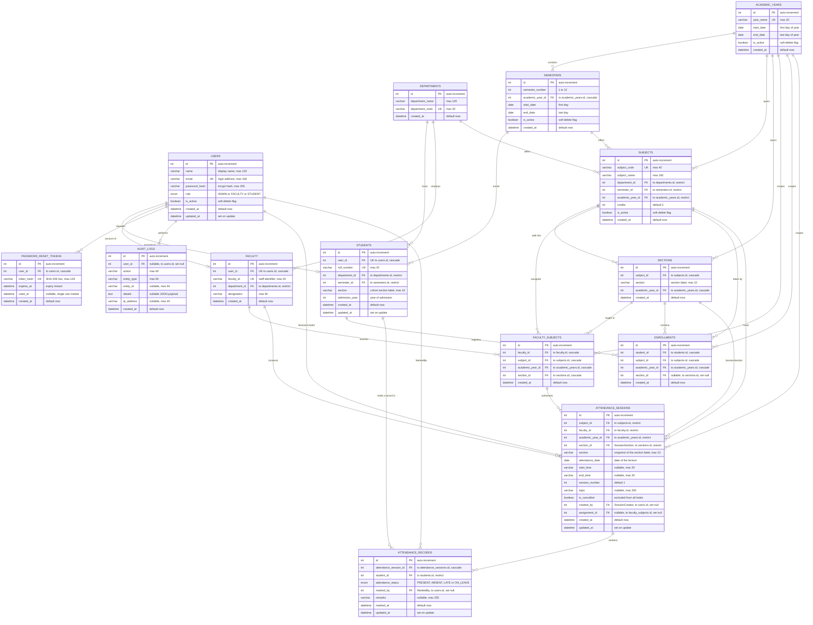

# Appendix A — Entity–Relationship Diagram and Attendance-Marking Workflow

This appendix presents the complete entity–relationship model of the AttendEase database and the
workflow by which an attendance session is created and marked.

**Source of truth.** Every entity, attribute, key and cardinality below has been read from
`backend/prisma/schema.prisma` and checked against the DDL in
`backend/prisma/migrations/20260101000000_init/migration.sql`.

**Entity count.** The schema contains **fourteen** models:

`User`, `PasswordResetToken`, `Department`, `AcademicYear`, `Semester`, `Section`, `Student`,
`Faculty`, `Subject`, `FacultySubject`, `Enrollment`, `AttendanceSession`, `AttendanceRecord`,
`AuditLog`.

Two enumerations support the model: `Role` (`ADMIN`, `FACULTY`, `STUDENT`) and `AttendanceStatus`
(`PRESENT`, `ABSENT`, `LATE`, `ON_LEAVE`).

---

## A.1 Entity–relationship diagram



---

## A.2 Verification of every relationship and cardinality

The table below states, for each relationship in the diagram, the Prisma field that defines it,
the column that carries the foreign key, the referenced column, the `onDelete` rule and the
cardinality implied by the nullability of the foreign key.

| # | Parent | Child | Prisma relation field | FK column → referenced | `onDelete` | Cardinality | Basis |
| --- | --- | --- | --- | --- | --- | --- | --- |
| 1 | `users` | `students` | `User.student` / `Student.user` | `students.user_id` → `users.id` | `Cascade` | one user ⇒ zero or one student; one student ⇒ exactly one user | `students.user_id` is `NOT NULL` and `UNIQUE` |
| 2 | `users` | `faculty` | `User.faculty` / `Faculty.user` | `faculty.user_id` → `users.id` | `Cascade` | one user ⇒ zero or one faculty member; one member ⇒ exactly one user | `faculty.user_id` is `NOT NULL` and `UNIQUE` |
| 3 | `users` | `password_reset_tokens` | `User.resetTokens` / `PasswordResetToken.user` | `password_reset_tokens.user_id` → `users.id` | `Cascade` | one user ⇒ zero or many tokens; one token ⇒ exactly one user | FK is `NOT NULL` |
| 4 | `users` | `audit_logs` | `User.auditLogs` / `AuditLog.user` | `audit_logs.user_id` → `users.id` | `SetNull` | one user ⇒ zero or many entries; one entry ⇒ zero or one user | FK is nullable; the entry survives the user |
| 5 | `users` | `attendance_sessions` | **`SessionCreator`** — `User.sessions` / `AttendanceSession.createdBy` | `attendance_sessions.created_by` → `users.id` | `SetNull` | one user ⇒ zero or many sessions; one session ⇒ zero or one creator | FK is nullable; the named relation disambiguates it from `AttendanceRecord.markedBy` |
| 6 | `users` | `attendance_records` | **`MarkedBy`** — `User.markedRecords` / `AttendanceRecord.markedBy` | `attendance_records.marked_by` → `users.id` | `SetNull` | one user ⇒ zero or many records; one record ⇒ zero or one marker | FK is nullable |
| 7 | `departments` | `students` | `Department.students` / `Student.department` | `students.department_id` → `departments.id` | `Restrict` | one department ⇒ zero or many students; one student ⇒ exactly one department | FK is `NOT NULL` |
| 8 | `departments` | `faculty` | `Department.faculty` / `Faculty.department` | `faculty.department_id` → `departments.id` | `Restrict` | one department ⇒ zero or many members; one member ⇒ exactly one department | FK is `NOT NULL` |
| 9 | `departments` | `subjects` | `Department.subjects` / `Subject.department` | `subjects.department_id` → `departments.id` | `Restrict` | one department ⇒ zero or many subjects; one subject ⇒ exactly one department | FK is `NOT NULL` |
| 10 | `academic_years` | `semesters` | `AcademicYear.semesters` / `Semester.academicYear` | `semesters.academic_year_id` → `academic_years.id` | `Cascade` | one year ⇒ zero or many semesters; one semester ⇒ exactly one year | FK is `NOT NULL` |
| 11 | `academic_years` | `subjects` | `AcademicYear.subjects` / `Subject.academicYear` | `subjects.academic_year_id` → `academic_years.id` | `Restrict` | one year ⇒ zero or many subjects; one subject ⇒ exactly one year | FK is `NOT NULL` |
| 12 | `academic_years` | `sections` | `AcademicYear.sections` / `Section.academicYear` | `sections.academic_year_id` → `academic_years.id` | `Cascade` | one year ⇒ zero or many sections; one section ⇒ exactly one year | FK is `NOT NULL` |
| 13 | `academic_years` | `faculty_subjects` | `AcademicYear.assignments` / `FacultySubject.academicYear` | `faculty_subjects.academic_year_id` → `academic_years.id` | `Cascade` | one year ⇒ zero or many assignments; one assignment ⇒ exactly one year | FK is `NOT NULL` |
| 14 | `academic_years` | `enrollments` | `AcademicYear.enrollments` / `Enrollment.academicYear` | `enrollments.academic_year_id` → `academic_years.id` | `Cascade` | one year ⇒ zero or many enrolments; one enrolment ⇒ exactly one year | FK is `NOT NULL` |
| 15 | `academic_years` | `attendance_sessions` | `AcademicYear.sessions` / `AttendanceSession.academicYear` | `attendance_sessions.academic_year_id` → `academic_years.id` | `Restrict` | one year ⇒ zero or many sessions; one session ⇒ exactly one year | FK is `NOT NULL` |
| 16 | `semesters` | `students` | `Semester.students` / `Student.semester` | `students.semester_id` → `semesters.id` | `Restrict` | one semester ⇒ zero or many students; one student ⇒ exactly one semester | FK is `NOT NULL` |
| 17 | `semesters` | `subjects` | `Semester.subjects` / `Subject.semester` | `subjects.semester_id` → `semesters.id` | `Restrict` | one semester ⇒ zero or many subjects; one subject ⇒ exactly one semester | FK is `NOT NULL` |
| 18 | `subjects` | `sections` | `Subject.sections` / `Section.subject` | `sections.subject_id` → `subjects.id` | `Cascade` | one subject ⇒ zero or many sections; one section ⇒ exactly one subject | FK is `NOT NULL` |
| 19 | `subjects` | `faculty_subjects` | `Subject.assignments` / `FacultySubject.subject` | `faculty_subjects.subject_id` → `subjects.id` | `Cascade` | one subject ⇒ zero or many assignments; one assignment ⇒ exactly one subject | FK is `NOT NULL` |
| 20 | `subjects` | `enrollments` | `Subject.enrollments` / `Enrollment.subject` | `enrollments.subject_id` → `subjects.id` | `Cascade` | one subject ⇒ zero or many enrolments; one enrolment ⇒ exactly one subject | FK is `NOT NULL` |
| 21 | `subjects` | `attendance_sessions` | `Subject.sessions` / `AttendanceSession.subject` | `attendance_sessions.subject_id` → `subjects.id` | `Restrict` | one subject ⇒ zero or many sessions; one session ⇒ exactly one subject | FK is `NOT NULL` |
| 22 | `faculty` | `faculty_subjects` | `Faculty.assignments` / `FacultySubject.faculty` | `faculty_subjects.faculty_id` → `faculty.id` | `Cascade` | one member ⇒ zero or many assignments; one assignment ⇒ exactly one member | FK is `NOT NULL` |
| 23 | `faculty` | `attendance_sessions` | `Faculty.sessions` / `AttendanceSession.faculty` | `attendance_sessions.faculty_id` → `faculty.id` | `Restrict` | one member ⇒ zero or many sessions; one session ⇒ exactly one member | FK is `NOT NULL` |
| 24 | `sections` | `faculty_subjects` | `Section.assignments` / `FacultySubject.section` | `faculty_subjects.section_id` → `sections.id` | `Cascade` | one section ⇒ zero or many assignments; one assignment ⇒ exactly one section | FK is `NOT NULL` |
| 25 | `sections` | `enrollments` | `Section.enrollments` / `Enrollment.section` | `enrollments.section_id` → `sections.id` | `SetNull` | one section ⇒ zero or many enrolments; one enrolment ⇒ zero or one section | FK is **nullable** — a student may be enrolled in a subject before the section is fixed |
| 26 | `sections` | `attendance_sessions` | **`SessionSection`** — `Section.sessions` / `AttendanceSession.sectionOffering` | `attendance_sessions.section_id` → `sections.id` | `Restrict` | one section ⇒ zero or many sessions; one session ⇒ exactly one section | FK is `NOT NULL`; the relation field is named `sectionOffering` because the session also stores a denormalised `section` string |
| 27 | `students` | `enrollments` | `Student.enrollments` / `Enrollment.student` | `enrollments.student_id` → `students.id` | `Cascade` | one student ⇒ zero or many enrolments; one enrolment ⇒ exactly one student | FK is `NOT NULL` |
| 28 | `students` | `attendance_records` | `Student.records` / `AttendanceRecord.student` | `attendance_records.student_id` → `students.id` | `Restrict` | one student ⇒ zero or many records; one record ⇒ exactly one student | FK is `NOT NULL` |
| 29 | `faculty_subjects` | `attendance_sessions` | `FacultySubject.sessions` / `AttendanceSession.assignment` | `attendance_sessions.assignment_id` → `faculty_subjects.id` | `SetNull` | one assignment ⇒ zero or many sessions; one session ⇒ zero or one assignment | FK is **nullable** |
| 30 | `attendance_sessions` | `attendance_records` | `AttendanceSession.records` / `AttendanceRecord.session` | `attendance_records.attendance_session_id` → `attendance_sessions.id` | `Cascade` | one session ⇒ zero or many records; one record ⇒ exactly one session | FK is `NOT NULL` |

### A.2.1 The two named relations called out in the specification

**`SessionSection`** — declared on the session as

```prisma
sectionOffering Section @relation("SessionSection", fields: [sectionId], references: [id], onDelete: Restrict)
```

and on the section as

```prisma
sessions AttendanceSession[] @relation("SessionSection")
```

The relation points from `attendance_sessions.section_id` to `sections.id`, is `NOT NULL` and uses
`ON DELETE RESTRICT`. The Prisma *field* on the session is called `sectionOffering` — not
`section` — because the session also carries a plain `String` attribute called `section` holding
the snapshot of the label. Naming the relation explicitly keeps the two apart in the generated
client; the diagram above labels the edge `SessionSection` accordingly.

**`SessionCreator`** — declared on the session as

```prisma
createdBy User? @relation("SessionCreator", fields: [createdById], references: [id], onDelete: SetNull)
```

and on the user as

```prisma
sessions AttendanceSession[] @relation("SessionCreator")
```

The relation points from the nullable `attendance_sessions.created_by` to `users.id`. It is
optional because the seed script creates historical sessions with `createdById: null`, and it uses
`ON DELETE SET NULL` so that deleting a user account cannot delete the sessions that the account
created.

A third named relation exists in the schema and is shown in the diagram for completeness:
**`MarkedBy`**, from `attendance_records.marked_by` to `users.id`, also nullable and also
`ON DELETE SET NULL`.

### A.2.2 Attributes that are not foreign keys

| Column | Table | Why it is not a foreign key |
| --- | --- | --- |
| `attendance_sessions.section` | `attendance_sessions` | A snapshot of `sections.section` at the moment the session was created. Deliberately not a key; see [`05-normalization.md`](./05-normalization.md) Section 4.1. |
| `students.section` | `students` | The cohort's current home section, stored as a label for convenience. The authoritative per-subject section is `enrollments.section_id`. |
| `audit_logs.entity_id` | `audit_logs` | A polymorphic reference to whichever entity the action concerned; stored as `VARCHAR(64)` because the referenced table differs from row to row. |
| `password_reset_tokens.token_hash` | `password_reset_tokens` | A SHA-256 digest of the emailed token. The raw token is never stored, so it cannot be replayed from a database dump. |

---

## A.3 Attendance-marking workflow

The workflow below is the path a faculty member follows from signing in to the record of a marked
class being committed to the database. Each step names the route, the guard that applies, the
controller and the tables read or written. The decision branches show the exact status code and
the error code returned on each rejection path.

```mermaid
flowchart TD
    START(["Faculty member signs in"]) --> LOGIN["POST /api/auth/login<br/>body: email, password<br/>validate: loginSchema"]
    LOGIN --> LOGIN_OK{"Credentials valid<br/>and user.is_active?"}
    LOGIN_OK -- No --> LOGIN_401["401 UNAUTHORIZED<br/>'Incorrect email or password'"]
    LOGIN_401 --> START

    LOGIN_OK -- Yes --> COOKIES["Set-Cookie: attendease_token = JWT (httpOnly, SameSite=Lax)<br/>Set-Cookie: attendease_csrf = random hex (readable)"]
    COOKIES --> AUDIT_LOGIN["Write audit_logs row<br/>action = LOGIN, entity_type = User"]
    AUDIT_LOGIN --> LAND["Faculty workspace '/faculty'"]

    LAND --> PICK["Select subject, section, date and session number"]
    PICK --> GUARDS["Middleware pipeline:<br/>helmet, CORS, apiLimiter, csrfProtection<br/>requireAuth, requireRole('ADMIN','FACULTY')"]
    GUARDS --> CSRF_OK{"X-CSRF-Token header matches<br/>attendease_csrf cookie?"}
    CSRF_OK -- No --> E403["403 FORBIDDEN<br/>'Invalid CSRF token'"]
    CSRF_OK -- Yes --> CREATE["POST /api/attendance/sessions<br/>body: subjectId, sectionId, attendanceDate,<br/>sessionNumber, startTime, endTime, topic"]

    CREATE --> V1{"attendanceDate is<br/>in the future?"}
    V1 -- Yes --> E400["400 BAD_REQUEST<br/>'Attendance cannot be recorded<br/>for a future date'"]
    V1 -- No --> V2{"Section exists and<br/>section.subject_id = subjectId?"}
    V2 -- No --> E404["404 NOT_FOUND<br/>'Section not found'"]
    V2 -- No --> E400B["400 BAD_REQUEST<br/>'The selected section does not belong<br/>to the selected subject'"]
    V2 -- Yes --> V3{"A faculty_subjects row exists for<br/>(subjectId, sectionId, academicYearId)<br/>belonging to the caller?"}
    V3 -- No, caller is FACULTY --> E403B["403 FORBIDDEN<br/>'You are not assigned to teach<br/>this subject and section'"]
    V3 -- No, caller is ADMIN --> E400C["400 BAD_REQUEST<br/>'No faculty member is assigned<br/>to this subject and section'"]
    V3 -- Yes --> V4{"unique_session_slot already exists?<br/>(subject_id, section_id, academic_year_id,<br/>attendance_date, session_number)"}
    V4 -- Yes --> E409["409 CONFLICT<br/>'Session N already exists for<br/>CODE on DATE'"]
    V4 -- No --> INSERT["INSERT INTO attendance_sessions<br/>+ snapshot the section label<br/>+ created_by = caller, assignment_id = assignment"]
    INSERT --> AUDIT_CREATE["Write audit_logs row<br/>action = CREATE, entity_type = AttendanceSession"]
    AUDIT_CREATE --> SESSION_CREATED["201 Created<br/>session with subject, faculty, section, year"]

    SESSION_CREATED --> ROSTER["GET /api/attendance/sessions/:id<br/>requireAuth"]
    ROSTER --> LOAD["Read enrollments for<br/>(subject_id, section_id)<br/>LEFT JOIN attendance_records of this session"]
    LOAD --> ROSTER_VIEW["Roster of enrolled students with<br/>current status, remarks, marker and time<br/>+ summary { present, absent, late, onLeave, unmarked }"]

    ROSTER_VIEW --> MARK["Faculty sets PRESENT / ABSENT / LATE / ON_LEAVE<br/>per student, with an optional remark"]
    MARK --> SUBMIT["POST /api/attendance/sessions/:id/records<br/>body: records[{ studentId, attendanceStatus, remarks }]<br/>max 1000 records"]

    SUBMIT --> W1{"Session exists and is not cancelled?"}
    W1 -- Cancelled --> E400D["400 BAD_REQUEST<br/>'This session has been cancelled'"]
    W1 -- Not found --> E404B["404 NOT_FOUND<br/>'Attendance session not found'"]
    W1 -- OK --> W2{"Caller is ADMIN or<br/>the session's own faculty member?"}
    W2 -- No --> E403C["403 FORBIDDEN<br/>'You can only mark attendance<br/>for subjects you teach'"]
    W2 -- Yes --> W3{"Every studentId is enrolled in<br/>the subject and section?"}
    W3 -- No --> E400E["400 BAD_REQUEST<br/>'One or more students are not enrolled<br/>in this section'<br/>details: { studentIds: [...] }"]
    W3 -- Yes --> W4{"No student appears twice<br/>in the payload?"}
    W4 -- No --> E400F["400 BAD_REQUEST<br/>'The same student was submitted<br/>more than once'"]

    W4 -- Yes --> TX["BEGIN TRANSACTION<br/>UPSERT attendance_records<br/>ON unique_student_per_session<br/>(attendance_session_id, student_id)"]
    TX --> COMMIT["COMMIT<br/>marked_by = caller, marked_at = now"]
    COMMIT --> AUDIT_SUBMIT["Write audit_logs row<br/>action = SUBMIT_ATTENDANCE<br/>details: { recordCount }"]
    AUDIT_SUBMIT --> SAVED["200 OK<br/>{ message, summary, total }"]

    SAVED --> CORRECT["Optional correction:<br/>PUT /api/attendance/records/:id<br/>body: attendanceStatus, remarks"]
    CORRECT --> C1{"Caller is ADMIN or<br/>owns the parent session?"}
    C1 -- No --> E403D["403 FORBIDDEN"]
    C1 -- Yes --> CUPDATE["UPDATE attendance_records<br/>+ audit_logs row<br/>action = UPDATE<br/>details: { from, to }"]
    CUPDATE --> CANCEL["Optional cancellation:<br/>POST /api/attendance/sessions/:id/cancel<br/>sets is_cancelled = TRUE"]
    CANCEL --> CANCEL_AUDIT["audit_logs row: action = CANCEL"]
    CANCEL_AUDIT --> END(["Session excluded from every<br/>percentage computation,<br/>history retained"])

    SAVED --> REPORT["GET /api/reports?reportType=...<br/>GET /api/attendance/student/:studentId<br/>GET /api/attendance/subject/:subjectId"]
    REPORT --> COMPUTE["Eligible sessions = is_cancelled = FALSE<br/>AND attendance_date <= CURDATE()<br/>attended = PRESENT + LATE (+ ON_LEAVE if configured)<br/>percentage = attended / eligible sessions"]
    COMPUTE --> SHOW["Dashboard, report table and CSV export"]
```



### A.3.1 The steps in prose

1. **Authentication.** `POST /api/auth/login` validates the body against `loginSchema`, calls
   `authenticate()` in `auth.service.ts`, which looks up the user by the lower-cased address and
   always performs a bcrypt comparison — using a dummy hash when the address is unknown, so that
   the response time does not disclose whether the account exists. On success the JWT is signed
   with the claims `sub`, `role`, `name`, `email` and placed in the `attendease_token` cookie with
   `httpOnly: true`, `sameSite: 'lax'` and `secure` set from `SECURE_COOKIES`; a CSRF token is
   issued in the readable `attendease_csrf` cookie; and a `LOGIN` entry is written to `audit_logs`.

2. **Authorisation and CSRF.** Every subsequent mutating request must carry the CSRF token in the
   `X-CSRF-Token` header; the middleware compares it against the cookie value using a
   constant-time comparison and answers HTTP 403 on a mismatch. `requireAuth` verifies the JWT and
   re-reads the account from the database, so a deactivation takes effect immediately.
   `requireRole('ADMIN', 'FACULTY')` then restricts the endpoint.

3. **Session creation.** `createSession` performs five checks in order: the date must not be in
   the future; the section must exist and must belong to the subject; a `faculty_subjects` row must
   authorise the calling member for that subject, section and academic year; the
   `unique_session_slot` key must be free; and the section label is copied into the
   `attendance_sessions.section` snapshot along with the `assignment_id` and `created_by`.

4. **Roster retrieval.** `getSession` reads the enrolments for the subject and section — this is
   the authoritative roster, and it is why a student who is not enrolled can never be marked —
   and left-joins the existing records for the session to produce the current state of the class
   together with the aggregate summary.

5. **Submission.** `submitRecords` rejects a cancelled session, rejects a caller who does not own
   the session, rejects any `studentId` that is not in the enrolment set, and rejects a payload
   that lists the same student twice. The save itself is a single `prisma.$transaction` of
   `upsert` operations keyed on `unique_student_per_session`, so re-submitting the same class
   updates the existing records rather than creating a second set.

6. **Correction and cancellation.** A single record may be corrected later through
   `PUT /api/attendance/records/:id`, which writes the previous and the new status to
   `audit_logs`. A session may be cancelled through `POST /api/attendance/sessions/:id/cancel`,
   which sets `is_cancelled = TRUE`; the session row is retained, but every aggregate filters it
   out through `eligibleSessionWhere()`.

7. **Consumption.** The recorded marks are consumed by the student summaries in
   `attendance.service.ts`, by the nine report types in `report.service.ts`, by the three
   dashboards in `dashboard.controller.ts` and by the twenty-one analytical queries in
   [`06-sql-queries.md`](./06-sql-queries.md).

---

## A.4 Cardinality summary

| Relationship | Type | Optionality of the child side |
| --- | --- | --- |
| `users` ↔ `students` | one-to-one | The student side is optional (a user may be a faculty member or an administrator). |
| `users` ↔ `faculty` | one-to-one | The faculty side is optional. |
| `users` → `password_reset_tokens` | one-to-many | Mandatory for the token. |
| `users` → `audit_logs` | one-to-many | Optional — the FK is nulled when the user is removed. |
| `users` → `attendance_sessions` | one-to-many | Optional — `created_by` is nulled. |
| `users` → `attendance_records` | one-to-many | Optional — `marked_by` is nulled. |
| `departments` → `students`, `faculty`, `subjects` | one-to-many | Mandatory. |
| `academic_years` → `semesters`, `subjects`, `sections`, `faculty_subjects`, `enrollments`, `attendance_sessions` | one-to-many | Mandatory. |
| `semesters` → `students`, `subjects` | one-to-many | Mandatory. |
| `subjects` → `sections`, `faculty_subjects`, `enrollments`, `attendance_sessions` | one-to-many | Mandatory. |
| `faculty` → `faculty_subjects`, `attendance_sessions` | one-to-many | Mandatory. |
| `sections` → `faculty_subjects` | one-to-many | Mandatory. |
| `sections` → `enrollments` | one-to-many | **Optional** — the enrolment may exist without a section. |
| `sections` → `attendance_sessions` | one-to-many | Mandatory. |
| `students` → `enrollments`, `attendance_records` | one-to-many | Mandatory. |
| `faculty_subjects` → `attendance_sessions` | one-to-many | **Optional** — the assignment reference is nulled. |
| `attendance_sessions` → `attendance_records` | one-to-many | Mandatory. |
| `students` ↔ `subjects` | many-to-many, resolved by `enrollments` | — |
| `faculty` ↔ `subjects` / `sections` / `academic_years` | many-to-many, resolved by `faculty_subjects` | — |
